# Claude AI Masterclass — Learner Guide

**Threads Edition**  |  **Course Code:** C1382  |  **Conducted by:** Tertiary Infotech Academy Pte Ltd (UEN 201200696W)  |  **Version v5.2 · 27 October 2026**

## Contents

- [Introduction](#introduction)
- [Course Learning Outcomes](#course-learning-outcomes)
- [Before You Start — Preparation](#before-you-start--preparation)
- [Working in a Claude Project](#working-in-a-claude-project)
  - [The lead agent and its threads](#the-lead-agent-and-its-threads)
  - [The parts of a project](#the-parts-of-a-project)
  - [Writing the goal](#writing-the-goal)
  - [Writing project instructions](#writing-project-instructions)
  - [Adding context](#adding-context)
  - [Working with memory](#working-with-memory)
  - [Scheduling tasks](#scheduling-tasks)
  - [Project settings, models and environments](#project-settings-models-and-environments)
- [Topic 01 — Claude Projects and Market Research](#topic-01--claude-projects-and-market-research)
  - [The Claude family](#the-claude-family)
  - [Lab 1 — Set Up the Lumo Launch Project](#lab-1--set-up-the-lumo-launch-project)
  - [Market research in parallel threads](#market-research-in-parallel-threads)
  - [Lab 2 — Run Market Research in Parallel Threads](#lab-2--run-market-research-in-parallel-threads)
  - [Live Artefacts](#live-artefacts)
  - [Lab 3 — Build the Market Insights Live Artefact](#lab-3--build-the-market-insights-live-artefact)
- [Topic 02 — Connectors, Skills and Plugins](#topic-02--connectors-skills-and-plugins)
  - [Connectors and the context window](#connectors-and-the-context-window)
  - [Lab 4 — Connect Google Drive and Gmail](#lab-4--connect-google-drive-and-gmail)
  - [Slides, Docs and built-in skills](#slides-docs-and-built-in-skills)
  - [Lab 5 — Create the Launch Deck and Campaign Brief](#lab-5--create-the-launch-deck-and-campaign-brief)
  - [Agent Skills](#agent-skills)
  - [Lab 6 — Capture the Brand Voice as an Agent Skill](#lab-6--capture-the-brand-voice-as-an-agent-skill)
  - [Skills, plugins and mods](#skills-plugins-and-mods)
  - [Lab 7 — Add the Marketing Plugin and a Mod](#lab-7--add-the-marketing-plugin-and-a-mod)
- [Topic 03 — Content Production and Scheduled Work](#topic-03--content-production-and-scheduled-work)
  - [Social content in parallel threads](#social-content-in-parallel-threads)
  - [Lab 8 — Create and Schedule Social Posts in Parallel Threads](#lab-8--create-and-schedule-social-posts-in-parallel-threads)
  - [The video pipeline](#the-video-pipeline)
  - [Lab 9 — Produce a 15-Second Launch Video](#lab-9--produce-a-15-second-launch-video)
  - [Scheduled tasks](#scheduled-tasks)
  - [Lab 10 — Schedule the Weekly Report and Review the Project](#lab-10--schedule-the-weekly-report-and-review-the-project)
- [Wrap-Up](#wrap-up)
- [Glossary](#glossary)


## Introduction

Claude is no longer only a chat window. With the redesigned Claude Projects, you give a project one goal and a lead agent plans the work, splits it into parallel threads and brings the results back to you. This course teaches that way of working through one continuous marketing scenario: you are the marketing team at Lumo Kopi Co., launching a new canned cold-brew kopi. Over ten labs, all inside one project, you research the market in parallel threads, build a Live Artefact dashboard, connect Google Drive and Gmail, produce a launch deck and campaign brief, capture the brand voice as a skill, add a marketing plugin, create two weeks of social posts and a launch video, and schedule the routine work so it runs on its own.

#### The scenario — The Lumo Cold Kopi launch

**The situation:** It is late October 2026. Lumo Kopi Co. launches Lumo Cold Kopi, its first ready-to-drink canned kopi, in Singapore on 1 December — six weeks away — and in Kuala Lumpur in January. The marketing team is small, the budget is S$60,000, and nothing has been produced yet: no research, no deck, no posts, no video.

**Your role:** You are the Lumo marketing team. Instead of juggling a dozen separate chats, you run the whole launch from one Claude Project. Its lead agent plans each job, starts parallel threads for the pieces, and brings the results back for you to check and approve.

**Your mission:** By the end of the day the project holds everything the launch needs — verified market research, a dashboard, a deck and brief, a brand-voice skill, two weeks of social posts, a launch video — and scheduled tasks that keep it moving while you are away.

Lumo Kopi Co. is a fictitious Singapore coffee brand about to launch Lumo Cold Kopi — a ready-to-drink oat-milk kopi cold brew in a 240 ml can — in Singapore on 1 December 2026 and Kuala Lumpur in January 2027. You are its marketing team. All brands, figures, survey answers and documents in this course are synthetic and used for training only.

This guide carries the full instructions for all 10 labs. Each lab folder in the course repository holds only the lab's prompt PDF and, where the lab needs it, a data folder; the goal, every prompt, the step-by-step instructions and the check step for each lab are here.


## Course Learning Outcomes

On completion of this course, you will be able to:

- LO1: Set up a Claude Project with a goal, instructions, context and memory, and explain how its lead agent splits work into parallel threads.
- LO2: Run multi-subject market research as parallel threads and consolidate it into one verified research brief.
- LO3: Build, refine, save and download a Live Artefact dashboard from supplied research data.
- LO4: Connect Google Drive and Gmail so Claude reads campaign files and sends an approved summary.
- LO5: Produce a launch deck and a campaign brief with Claude's Slides and Docs, using built-in skills.
- LO6: Capture a brand voice as an Agent Skill with /skill-creator, and install and use a marketing plugin.
- LO7: Create a two-week, multi-platform set of social media posts in parallel threads using the brand-voice skill.
- LO8: Produce a short vertical launch video from a script, storyboard and supplied brand assets.
- LO9: Schedule recurring project tasks, maintain project memory and review thread usage, keeping a human approval step.


## Before You Start — Preparation

#### What you need

- A laptop (Mac or Windows) with the Claude desktop app installed from claude.ai/download.
- A Claude account on a paid plan (Pro or Max) — Projects, Cowork and Live Artefacts are paid-plan features.
- A Google account with Google Drive and Gmail, used for the connector labs.
- The course labs downloaded from https://github.com/tertiarycourses/C1382-Claude-AI-Masterclass — each lab folder holds a prompt PDF and, where needed, a data folder.
- The prompts page open in a browser, so you can copy each prompt with one click: https://tertiarycourses.github.io/C1382-Claude-AI-Masterclass/prompts/threads/

#### Claude plans

Free lets you try Claude; Cowork, scheduled tasks and full Projects need Pro or Max.

| Plan | Price and what it adds |
|---|---|
| Free | $0. Chat, Slides, Docs, connectors and skills, up to five projects. Sonnet and Haiku. |
| Pro | $17/mo billed annually · $20 monthly. Cowork, scheduled tasks, the new Projects (beta), Opus. |
| Max | From $100/mo — 5× or 20× Pro's usage, priority at busy times, $100–$200/mo API credits. |
| Team · Enterprise | Team $20/seat annual ($25 monthly), premium seats $100. Enterprise $20/seat + usage. |

Usage resets every five hours, with weekly limits on paid plans. US$ prices as of 27 October 2026 — verify at claude.com/pricing.

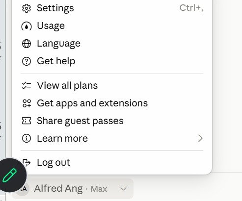

*Figure 1 — Check Your Plan and Usage. Click your name at the bottom of the sidebar — the plan shows beside it (here, Max).*

1. **Usage** — How much of your five-hour and weekly limits you have used.
2. **View all plans** — Compare Free, Pro, Max, Team and Enterprise, and upgrade.
3. **Settings** — Your profile, connectors and capabilities. Shortcut: Ctrl + comma.

#### Claude models

Four families, smallest to most capable; all read up to 1M tokens. API prices are US$ per million tokens, input · output.

| Model | What it is | Use it for | API price | On plans |
|---|---|---|---|---|
| Haiku 5.5 | Fastest, most cost-efficient | Quick, high-volume jobs: tagging, short replies | $0.10 / $0.50 | All plans |
| Sonnet 5.5 | High performance for coding and agents | Everyday drafting, research and analysis | $2 / $10 | All plans |
| Opus 5.5 | Daily driver for agentic and enterprise work | Multi-step projects, parallel work, careful reviews | $4 / $20 | Pro and above |
| Fable 5.1 | Most capable, for long-running agents | The hardest, longest jobs | $10 / $50 | Max; Pro via usage credits |

Pick the model from the model menu. Bigger models think harder and use more of your plan — save Fable for the jobs that need it.

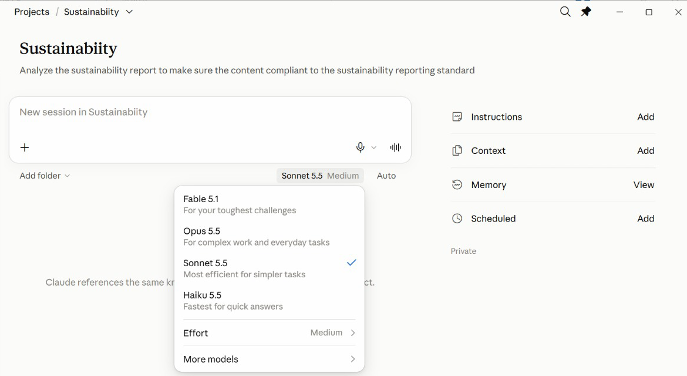

*Figure 2 — Pick a Model in the App. The model menu sits under the message box of every new session.*

1. **Fable 5.1** — For your toughest challenges — uses the most of your plan.
2. **Opus 5.5** — Complex work and everyday tasks.
3. **Sonnet 5.5** — Efficient for most jobs — a sensible default.
4. **Haiku 5.5** — Fastest, for quick answers.

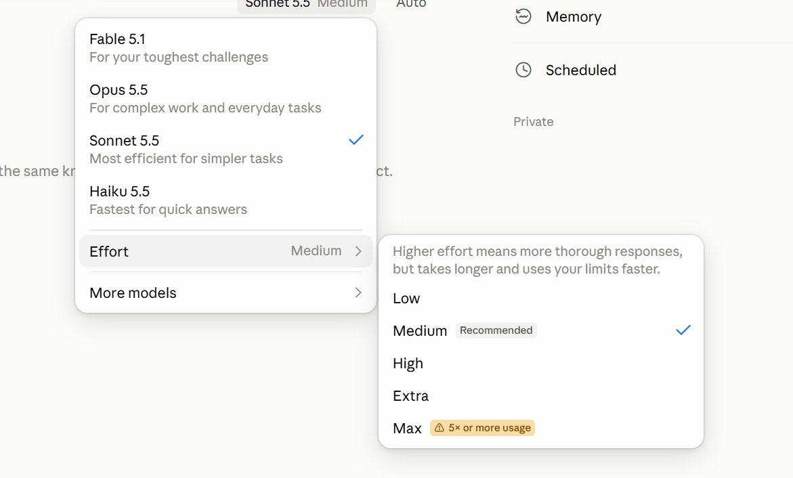

*Figure 3 — Effort: How Hard Claude Thinks. Model menu → Effort. Medium is recommended for most work.*

1. **Low · Medium** — Quick, everyday work. Medium is the recommended default.
2. **High · Extra** — Harder problems: more thorough, but slower and uses your limits faster.
3. **Max** — Five times or more the usage — save it for the hardest job.

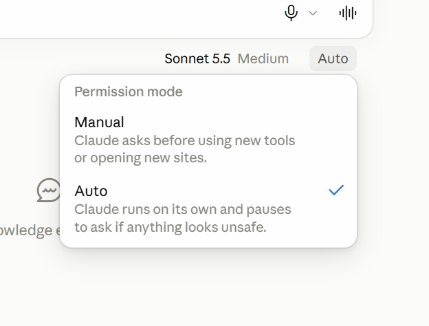

*Figure 4 — Permission Mode: Manual or Auto. The menu beside the model sets how freely Claude acts in a session.*

1. **Manual** — Claude asks before it uses a new tool or opens a new site.
2. **Auto** — Claude runs on its own and pauses to ask only if something looks unsafe.
3. **Which to use** — Manual while you learn a new connector; Auto once you trust the job.

#### Verify your setup

Open the Claude desktop app, sign in, and open Projects from the sidebar. If you can see the New project button, your account has the new Projects. If you cannot, the beta has not reached your account yet: run each lab in Cowork mode instead, and attach the lab's data files yourself — every prompt still works.

#### Course links

| Resource | Address |
|---|---|
| Course repository (lab files) | https://github.com/tertiarycourses/C1382-Claude-AI-Masterclass |
| Copy-ready prompts page | https://tertiarycourses.github.io/C1382-Claude-AI-Masterclass/prompts/threads/ |

#### Conventions used in every lab

- Prompts shown in a bordered box are copied into Claude exactly as they are — or copy them from the prompts page.
- Placeholders such as `<YOUR EMAIL>` are replaced with your own values.
- All Lumo Kopi data is synthetic; use only the supplied mock data.
- Every lab ends with a check step — confirm the output before moving on.

#### Rules for every lab

- **Work from mock data** — Use the supplied synthetic Lumo data — never real customer records in training.
- **Scope the connector** — Give Claude one Drive folder for the task, not your entire Drive.
- **Check every figure** — Read the artefact's and the brief's numbers back against the source file.
- **Approve before sending** — Read each drafted email and post in full; approve it only when the facts match.
- **Use a test recipient** — Send class exercises to yourself, never to a real customer.
- **Watch thread usage** — Parallel threads multiply usage — check Project settings → Usage.

> **Note:** Use only the supplied mock data and your own test accounts. Never put real customer, personal or confidential data into a training exercise, and send lab emails to yourself rather than to a real recipient.


## Working in a Claude Project

Every lab in this course runs inside one Claude Project — Lumo Cold Kopi Launch — which you create in Lab 1. This chapter explains how a project works and how to set up each of its parts. Come back to it whenever a lab asks you to change the goal, instructions, context, memory or a scheduled task.


### The lead agent and its threads

One goal, one lead agent, many threads. You talk to the lead agent. It decides how many threads a job needs, gives each a focused brief, and brings one merged answer back to you.

- **Lead agent** — Plans, splits and merges
- **Thread 1** — Competitors
- **Thread 2** — Customer survey
- **Thread 3** — Pricing
- **Thread 4** — Social trends
- **Memory** — Shared by every thread

How this changes the way you work:

| Before — one chat per job | Now — a Project with a lead agent |
|---|---|
| A chat for copy, one for visuals, one for competitors. | You state the goal once, to the lead agent. |
| Re-explain the brand in every new chat. | It splits the work and starts parallel threads. |
| Copy and paste results between chats yourself. | Each thread reports back; the lead merges the results. |
| Nothing happens while your laptop is closed. | Goal, memory and context persist across every thread. |
| You are the project manager. | It only comes back to you when it needs a decision. |

#### Projects and sessions

The project is the room; a session is one working day in it. A session is one conversation with Claude; a project is the workspace that holds many of them and loads the same set-up into each.

| A session — one piece of work | A project — the whole goal |
|---|---|
| One conversation with Claude: a chat, or a thread the lead agent starts. | A lasting workspace that holds many sessions. |
| Has its own context window, which fills up as you work. | Its goal, instructions, context and memory load into every session. |
| Ends when the job is done; the next session starts blank. | Stays until you delete it — for weeks or months. |
| Remembers only what was said inside it. | What one session learns, the next can use, through memory. |
| Lumo: “Draft the Instagram launch post.” | Lumo: “Lumo Cold Kopi Launch.” |

**Project, Session, Thread and Agent**

- **Project** — The workspace for one goal. Its goal, instructions, context and memory are shared by every session in it.
- **Session** — One conversation with Claude, with its own context window.
- **Lead agent** — The agent you talk to in your session. It plans the job, starts threads and merges their results.
- **Thread** — A session the lead agent starts for one piece of the job, run by its own agent.
- **Agent** — The Claude doing the work in a session — the lead agent, or a thread's agent.

Each thread has its own agent and context window. The lead agent merges what they return into one answer for you.

#### Four questions a project answers

Set these up once and every session in the project starts from them.

| Part | Answers | What it means |
|---|---|---|
| Instructions | HOW | How Claude must work: brand voice, prices in S$, ask before sending — rules every session follows. |
| Context | WHAT | What Claude needs to know: brand guidelines, product sheet, launch brief — read, never edited. |
| Folder | WHERE | Where Claude works and saves: the project files on your computer, or a cloud environment. |
| Scheduled | WHEN | When work runs without you: Monday 9am the week's post drafts, Friday the weekly report. |

The goal says WHY; memory keeps what each session learns for the next.

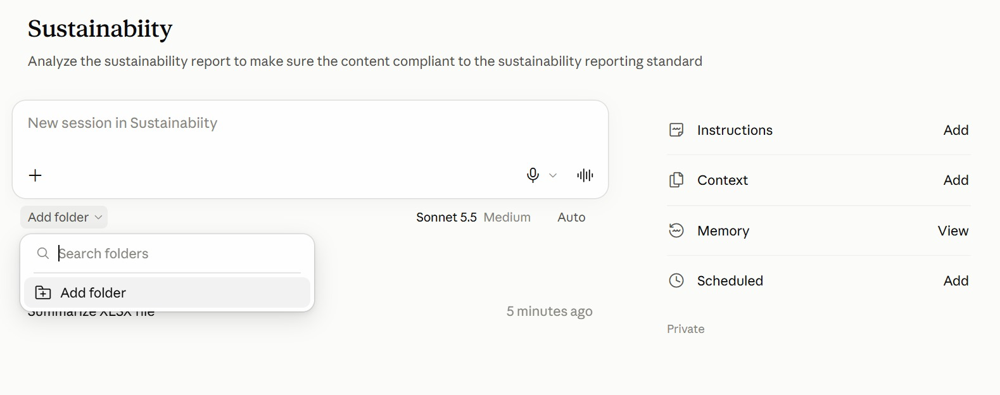

*Figure 5 — The Project Page in the App. A project from the class: the goal under its name, the project's panels on the right.*

1. **Instructions · Context** — HOW and WHAT — click Add to write the rules or attach reference files.
2. **Add folder** — WHERE — under the message box, pick the folder Claude reads from and saves to.
3. **Memory · Scheduled** — What Claude has learned about the project, and WHEN tasks run on their own.
4. **New session** — Type in the box to start a session; earlier sessions are listed beneath it.

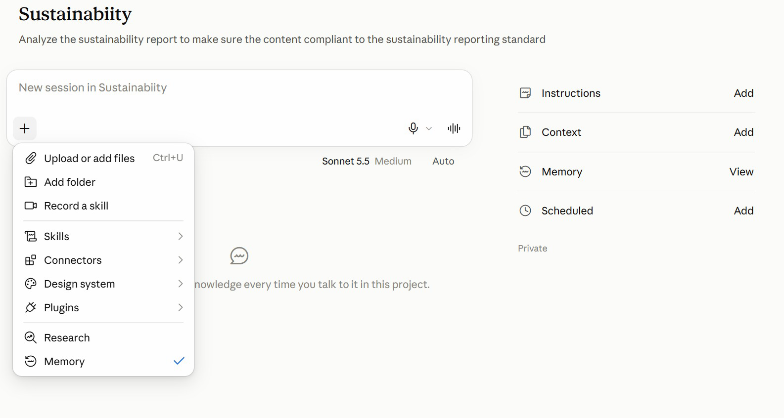

*Figure 6 — The + Menu: What a Session Can Use. Click + in the message box to bring files and tools into the session.*

1. **Files and folders** — Upload a file, or add a folder, for this session.
2. **Skills · Connectors · Plugins** — Choose what the session may use — the brand-voice skill, Gmail, a plugin.
3. **Record a skill** — Capture a routine you show Claude as a new skill.
4. **Research · Memory** — Deeper web research; the tick shows the session uses project memory.

#### When to use a project

| Use a project for | Why |
|---|---|
| A long-running goal | Work keeps arriving for weeks — a product launch, a channel, an app. |
| A job that splits | One big job breaks into pieces that can run at once — assets, ads, competitors, email. |
| Lots of research | Many subjects to look into — one thread per competitor, market or segment. |
| Regular check-ins | You want to review each workstream's progress, not one long chat. |

A one-off question that is done in one reply? Use an ordinary chat.


### The parts of a project

| Part | What it is |
|---|---|
| Goal | What the project must achieve. The lead agent steers every decision toward it. |
| Instructions | Standing rules you write: brand voice, currency, never publish without approval. |
| Context | What Claude reads: files, folders, a Google Drive folder or a GitHub repository. |
| Memory | What the project learns and keeps between threads. Open the memory files to edit them. |
| Threads | The parallel workers the lead agent starts for each piece of a job. |
| Scheduled | Tasks that run on a timetable inside the project — the daily post, the weekly report. |

#### Creating a project

1. **Name** — What you are working on — Lumo Cold Kopi Launch. This is how you find it in the sidebar.
2. **Goal** — What the project must achieve, in two or three sentences. You can type it or dictate it.
3. **Context** — Add the brand kit files now, or a folder or Drive folder. You can skip and add them later.
4. **Create project** — The lead agent opens, reads the goal and context, and is ready for its first job.

New project is at the top right of the Projects page. Instructions and memory are edited afterwards, in Project settings.

#### Instructions or context?

Quick test: a sentence that starts Always, Never or Write in… is an instruction. A document is context.

| Instructions — how to behave | Context — what to know |
|---|---|
| Short standing rules you write yourself. | Reference material Claude reads but never edits. |
| Followed by every session in the project. | Files, a folder, a Google Drive folder or a GitHub repository. |
| Like the house rules pinned on the office wall. | Like the reference binders on the office shelf. |
| Keep them short: they are loaded into every session. | Add it once; you never re-attach it again. |
| Lumo: “Prices in S$. No health claims. Ask before sending.” | Lumo: brand guidelines, product sheet, launch brief. |

#### Instructions, context and memory compared

These three are easy to confuse, and the difference matters: when an output is wrong, it tells you which one to fix.

|  | Instructions | Context | Memory |
|---|---|---|---|
| Who writes it | You | You add it | The project, as it works |
| What it holds | Rules and style | Files and folders to read | Facts and decisions learned |
| Lumo example | Prices in S$; no health claims | Brand guidelines, launch brief | Launch date moved; IG performs best |
| Edit it in | Settings → Memory | Context panel | Settings → Memory → memory files |
| When output is wrong | Tighten the rule | Add the missing file | Correct or delete the fact |

#### An analogy: the project room

Picture the project as a room your team works in for the whole launch.

| In Claude | In the office | What it means | Lumo example |
|---|---|---|---|
| Project | The project room | Stays set up for weeks | Lumo Cold Kopi Launch |
| Session | One working day in the room | Starts fresh; the room is still set up | Draft the Instagram post |
| Lead agent | The team lead | Splits the job, merges the results | Four research threads, one brief |
| Instructions | House rules on the wall | How every session must behave | Prices in S$; no health claims |
| Context | Binders on the shelf | What Claude reads, never edits | Brand guidelines, product sheet |
| Memory | The team logbook | Decisions kept between sessions | Launch price confirmed at S$3.90 |
| Scheduled | The room's recurring calendar | Work that runs on a timetable | Monday 9am: the week's posts |


### Writing the goal

The goal is the one statement every decision in the project points at. The lead agent reads it before it plans any job, so a vague goal produces vague plans.

Write it as an outcome with a date and a measure: what will exist, for whom, and how you will know it worked. Two or three sentences is enough.

**Example**

*EXAMPLE — Lumo Kopi*

```text
Launch Lumo Cold Kopi in Singapore on 1 December 2026. Produce the
research, launch deck, campaign brief, two weeks of social posts and a
15-second launch video, within a S$60,000 budget, so that 25-34
year-olds on Instagram and TikTok know the product exists by launch day.
```

**How to do it**

1. Open the project and click the gear icon to open Project settings.
2. Under General, edit the goal and save.
3. Ask the lead agent: "Restate the project goal in one line." If it gets it wrong, the goal is unclear.


### Writing project instructions

Instructions are standing rules that apply to every thread and every job in the project. Use them for things that are always true: the currency, the brand voice in brief, what must never happen without your approval.

Keep them short and testable. A rule Claude can check — "prices always in S$ with two decimals" — works far better than a wish such as "be professional".

**Example**

*EXAMPLE — Lumo Kopi*

```text
You are the marketing team for Lumo Kopi Co.
- Prices are in Singapore dollars: S$3.90 per can, S$42.00 per 12-pack.
- Follow lumo-brand-guidelines.md for anything customer-facing.
- Never describe the product as healthy; you may say 5 g sugar.
- Never send an email or publish a post without my approval.
- Save outputs to the project folder with the date in the filename.
```

**How to do it**

1. Open Project settings and choose Memory.
2. Paste the instructions into Project instructions and save.
3. Start a new job and check that the rules are followed without you repeating them.


### Adding context

Context is what the project reads: the brand guidelines, the product sheet, the launch brief. Claude reads context but does not edit it, so it is the right home for reference material you want kept exactly as it is.

Add only what the work needs. Every file in context competes for space in each thread's context window, so a lean set of reference files gives sharper answers than a whole shared drive.

**How to do it**

1. In the project, open the Context panel and choose Add.
2. Add files, a folder from your computer, or a Google Drive folder.
3. Ask: "Which context files do you have, and what is each one for?"


### Working with memory

Memory is what the project writes down for itself as it works: decisions you made, facts it discovered, what performed well. Every thread can read it, which is how something learned in one thread reaches the next.

Because the project writes it, memory can be wrong. Open the memory files from time to time, correct anything out of date and delete anything you do not want kept. Treat it like a shared notebook that you are responsible for.

**Example**

*EXAMPLE — Lumo Kopi*

```text
Remember this for the project: the Singapore launch date has moved from
1 December to 8 December 2026. Update anything you have planned that
depends on it.
```

**How to do it**

1. Open Project settings → Memory and open a memory file.
2. Edit or delete a line, then save.
3. Or tell the lead agent what to remember, and check the memory file afterwards.


### Scheduling tasks

A scheduled task is a prompt the project runs on a timetable. Because it runs inside the project, it has the goal, instructions, context, memory and skills — you do not repeat any of them in the task.

Schedule drafts, not publishing. A good marketing task prepares today's post and emails it to you for approval; the click that publishes stays yours. If your workspace has a social-scheduling connector, the task can queue the approved post — still behind your approval.

**Example**

*EXAMPLE — Lumo Kopi*

```text
Every weekday at 9:00am: take today's row from social-calendar.csv,
polish the post with lumo-brand-voice, check every price and claim
against the brand kit, and email it to me as a draft with the subject
"Today's Lumo post". Never publish anything.
```

**How to do it**

1. In the project, ask the lead agent to schedule the task, or open Scheduled and choose New task.
2. Set the prompt, the frequency and the time, and save.
3. Use Run now once to test it, then check the email that arrives.
4. For tasks that must run with your laptop closed, add a cloud environment in Project settings → Environment.


### Project settings, models and environments

| Settings page | What you find there |
|---|---|
| General | The project name, the goal, and the models and effort for the lead agent and the threads. |
| Memory | The project instructions and the memory files the project has written — open one to edit it. |
| Environment | Local, or a cloud environment so threads keep working with your laptop closed. |
| Usage | Input and output tokens, for the lead agent and for each thread separately. |
| Debug access | Let another project read this one's conversations, read-only, to help diagnose a problem. |

Open Project settings from the gear icon at the top right of the project.

#### Models and effort

| Role | Typical default | Effort | Change it when |
|---|---|---|---|
| Lead agent | Opus 5.5 | Low | It misreads your requests — raise to Medium. |
| Threads | Opus 5.5 | Medium | Research is shallow — raise; drafts are simple — lower. |
| Effort | — | Low · Medium · High | Higher effort thinks harder and uses more of your limit. |

Defaults vary by account and change over time — read yours in Project settings → General → Models.

#### Cloud environments

A local task needs the app open. To keep tasks running with the laptop closed, give the project a cloud environment in Project settings → Environment.

| Setting | What it controls |
|---|---|
| Network access | Which websites the threads may reach — add only the ones the work needs. |
| Secrets | API keys the threads can use. Once saved, nobody can read them back — not even you. |
| Setup script | What each thread installs before it starts work, such as one package-install line. |


## Topic 01 — Claude Projects and Market Research

The Claude family · the new Projects · lead agent and threads · market research · Live Artefacts

#### Key concepts

| Concept | What it means |
|---|---|
| Claude Project | A home for a long-running goal. Context, memory and work build up over time instead of resetting each chat. |
| Lead agent | The project's coordinator. You tell it the goal; it plans, splits the work and reports back. |
| Threads | Parallel workers the lead agent starts — one per subject — each with its own focused context. |
| Goal | One clear statement of what the project must achieve. Every decision the lead agent makes points at it. |
| Instructions vs memory | Instructions are the rules you write. Memory is what the project learns and keeps — and you can edit it. |
| Live Artefacts | Interactive tools — dashboards, trackers — that persist in your workspace instead of scrolling away in chat. |


### The Claude family

| Product | Role | What it does |
|---|---|---|
| Claude (Chat + Cowork) | Thinking and work partner — this course | • Chat: ask, draft, analyse and research with web search<br>• Cowork: plans and runs multi-step tasks on your files<br>• Projects, connectors and skills: Drive, Gmail, Calendar<br>• For everyone — web, desktop and mobile apps |
| Claude Code | Build partner | • Builds software, sites and automations<br>• Runs in the terminal, VS Code, desktop app and web<br>• Edits files, runs commands and calls MCP tools<br>• Extended with CLAUDE.md, skills, sub agents and hooks |

Chat and Cowork are now one app: Claude. A marketing team works there — and a Project ties the work together around one goal.


### Lab 1 — Set Up the Lumo Launch Project

**Objective:** By the end of this lab you can create a Claude Project with a goal, instructions, context and memory.

**Scenario:** Lumo Kopi Co. launches Lumo Cold Kopi in six weeks, and the marketing work will keep coming until launch day — exactly what a Claude Project is for. You create the Lumo Cold Kopi Launch project, give it a goal, add the brand kit as context, write its standing instructions, and check that its lead agent understood all three. Every later lab runs inside this project.

**You will build:** The Lumo Cold Kopi Launch project, with a goal, instructions, three context files and a first memory entry.

**Tools:** Claude desktop app, Claude Projects.

#### In the project

| Part | In this lab |
|---|---|
| Instructions — HOW | Set up: paste Block 2 into Project settings → Memory — S$ prices, brand guidelines, no health claims, approval first. |
| Context — WHAT | Set up: add the brand kit — guidelines, product sheet and launch brief. |
| Folder — WHERE | Outputs are saved in the project. Local by default; Topic 3 adds a cloud environment. |
| Scheduled — WHEN | Not yet — Lab 8 adds the first scheduled task. |

#### Lab files

- Prompt PDF: labs-threads/lab-01-set-up-the-launch-project/lab-01-set-up-the-launch-project.pdf
- labs-threads/lab-01-set-up-the-launch-project/data/brand-kit/lumo-brand-guidelines.md
- labs-threads/lab-01-set-up-the-launch-project/data/brand-kit/lumo-product-sheet.md
- labs-threads/lab-01-set-up-the-launch-project/data/brand-kit/lumo-launch-brief.md

#### Step-by-step

This lab has three blocks. Block 1 is the project goal, typed into the New project dialog. Block 2 is the standing instructions, pasted into Project settings → Memory. Block 3 is your first message to the lead agent.

> **Note:** No Projects in your sidebar yet? The beta has not reached your account. Switch to Cowork mode, attach the three brand-kit files, paste Block 2 as your first message, then send Block 3.

1. Download the course labs and open the Lab 01 data/brand-kit folder.  
   *Why:* Skim the three files — guidelines, product sheet, launch brief. You will check Claude's answers against them.
2. In the Claude desktop app, open Projects from the sidebar and click New project.  
   *Why:* Projects are shared across the Claude app (Chat and Cowork) and Claude Code, so the same project is reachable from all three.
3. Name the project Lumo Cold Kopi Launch and paste Block 1 into the Goal field.  
   *Why:* The goal is what the lead agent steers every decision toward, so it is worth writing as an outcome with a date and a measure.

   **Block 1 — GOAL**

   Paste this into the Goal field of the New project dialog:

   *PROMPT — copy into Claude*

   ```text
   Launch Lumo Cold Kopi in Singapore on 1 December 2026.
   Produce the market research, a launch deck, a campaign brief,
   two weeks of social media posts and a 15-second launch video,
   within a S$60,000 budget, so that 25-34 year-olds on Instagram
   and TikTok know the product exists by launch day.
   ```

   Name the project **Lumo Cold Kopi Launch**, add the three brand-kit files as Context, and click **Create project**.


4. Under Context, add the three brand-kit files, then click Create project.  
   *Why:* Context is read, never edited — the right home for reference files you want kept exactly as they are.
5. Click the gear icon to open Project settings, choose Memory, and paste Block 2 into Project instructions. Save.  
   *Why:* Instructions are standing rules for every thread. Short, checkable rules work better than general wishes.

   **Block 2 — INSTRUCTIONS**

   Paste this into Project settings → Memory → Project instructions:

   *PROMPT — copy into Claude*

   ```text
   You are the marketing team for Lumo Kopi Co.
   - Prices are in Singapore dollars: S$3.90 per can, S$42.00 per
     12-pack. Always two decimals.
   - Follow lumo-brand-guidelines.md for anything customer-facing.
   - Never describe the product as healthy. You may say 5 g sugar.
   - Never send an email or publish a post without my approval.
   - When a job has several independent subjects, give each one
     its own thread and merge the results for me.
   - Flag any figure that two sources disagree on. Do not pick one.
   ```

   Save the instructions, then go back to the project and send Block 3.


6. While you are in settings, open General and look at Models.  
   *Why:* Note the model and effort for the lead agent and for threads. You will see their cost in Lab 10.
7. Back in the project, send Block 3 to the lead agent.  
   *Why:* This is a setup check: if it cannot restate the goal or find the files, fix that now, before any real work.

   **Block 3 — FIRST MESSAGE**

   Send this to the lead agent:

   *PROMPT — copy into Claude*

   ```text
   Before we start work, check your setup:
   1. Restate the project goal in one line.
   2. List the context files you can read and what each is for.
   3. List the three instructions you think matter most.
   4. From the product sheet, give me the price per can, the sugar
      per can and the launch date.
   Then remember this for the project: our primary audience is
   25-34 year-olds in Singapore, and our secondary market is
   Kuala Lumpur, launching 15 January 2027.
   ```

   Compare the answer with the brand kit, then open Project settings → Memory and find the new memory entry.


8. Check the answers: S$3.90 per can, 5 g sugar, launch 1 December 2026.  
   *Why:* Every figure must match the product sheet. A wrong figure here means a wrong context file.
9. Open Project settings → Memory and find the memory entry about the audience and Kuala Lumpur.  
   *Why:* The project wrote it, so you are responsible for it. Memory you never read is memory you cannot trust.

#### Check

> **Check — you are done when:** The Lumo Cold Kopi Launch project exists with the goal from Block 1, the three brand-kit files under Context and the Block 2 instructions saved. The lead agent restated the goal, listed all three context files, and quoted S$3.90 per can, 5 g sugar and a 1 December 2026 launch. A memory file now records the 25-34 audience and the 15 January 2027 Kuala Lumpur launch.


### Market research in parallel threads

In Lab 2 you hand the lead agent one research job with four independent subjects. It starts one thread per subject:

| Thread | What it researches |
|---|---|
| Competitors | Six cold-brew brands: price, pack, positioning, and the gap Lumo can own. |
| Customer survey | 400 respondents: who is likely to buy, why, and where they discover drinks. |
| Pricing | Where S$3.90 sits against the market, and what the survey says people will pay. |
| Social trends | Which content themes earn the most engagement in the category right now. |

Each thread gets one subject and its own data file. The lead agent merges the four findings into one research brief — and flags where they disagree.


### Lab 2 — Run Market Research in Parallel Threads

**Objective:** By the end of this lab you can hand a multi-subject research job to the lead agent and verify the merged brief.

**Scenario:** Before anyone writes a post, the team needs to know the market. Four subjects need research — competitors, the customer survey, pricing and social trends — and none depends on another. You give the whole job to the lead agent in one message. It starts one thread per subject, each with its own data file, then merges the four findings into one research brief, which you check against the data.

**You will build:** A research brief (lumo-research-brief.docx) merged from four parallel threads, saved in the project.

**Tools:** Claude Projects, lead agent and threads, web search.

#### In the project

| Part | In this lab |
|---|---|
| Instructions — HOW | Uses: one thread per subject, and flag any figure two sources disagree on. |
| Context — WHAT | Uses: the launch brief, so every thread knows the product, price and audience. |
| Folder — WHERE | Adds: attach the three CSVs; lumo-research-brief.docx is saved in the project. |
| Scheduled — WHEN | Not used — the four threads run now, in parallel. |

#### Lab files

- Prompt PDF: labs-threads/lab-02-market-research-threads/lab-02-market-research-threads.pdf
- labs-threads/lab-02-market-research-threads/data/lumo-consumer-survey-2026.csv
- labs-threads/lab-02-market-research-threads/data/lumo-competitors.csv
- labs-threads/lab-02-market-research-threads/data/lumo-social-trends.csv

#### Step-by-step

1. Open the Lab 02 data folder and glance at the three CSV files.  
   *Why:* Know your source: 400 survey rows, six competitors, twelve content themes.
2. In the Lumo Cold Kopi Launch project, attach the three files and send the lab prompt.  
   *Why:* One message, four subjects. You are briefing the lead agent, not doing the splitting yourself.

   *PROMPT — copy into Claude*

   ```text
   Research the market for the Lumo Cold Kopi launch. The data is in
   the three files I have attached. Split this into four threads,
   one per subject, and run them in parallel:

   Thread 1 - COMPETITORS (lumo-competitors.csv): price per can, pack,
     positioning and channel for each brand. Where is the gap Lumo
     can own?
   Thread 2 - CUSTOMERS (lumo-consumer-survey-2026.csv): share likely
     to buy (intent 4 or 5), split by age band and city; top purchase
     drivers; top discovery channels.
   Thread 3 - PRICING: where S$3.90 sits against the competitor
     median, and the share of respondents willing to pay S$3.50 or
     more.
   Thread 4 - SOCIAL TRENDS (lumo-social-trends.csv): the three content
     themes with the highest engagement, with one post idea each.

   When all four threads are done, merge them into one research brief,
   lumo-research-brief.docx: a one-paragraph summary, one section per
   thread with the key numbers, and three recommendations for the
   launch. Show your working for every percentage. Tell me which
   thread produced each section, and flag anything the threads
   disagree on.
   ```

   > **Note:** Attach the three CSV files from the Lab 02 data folder, or add them to the project's Context first.


3. Watch the lead agent announce the threads it starts.  
   *Why:* Each thread has one subject and one file — a focused brief with a fresh context window. That is why parallel research stays sharp.
4. Open one thread while it works and read its brief.  
   *Why:* You can see exactly what the lead agent asked each thread to do. A poor result usually traces back to a poor thread brief.
5. When the merged brief arrives, check the survey numbers.  
   *Why:* Expect 400 respondents, 248 likely to buy (62%), and 112 of 152 in the 25-34 band (74%).
6. Check the channel and driver findings.  
   *Why:* Instagram is the top discovery channel at 136 (34%), then TikTok at 104 (26%). Taste is the top driver at 124 (31%).
7. Check the pricing section.  
   *Why:* The competitor median is S$4.30, so S$3.90 sits below it; 228 respondents (57%) would pay S$3.50 or more.
8. Check the trends section and the recommendations.  
   *Why:* The top theme should be Taste tests and first-sip reactions. Do the three recommendations follow from the numbers above them?
9. Open lumo-research-brief.docx and confirm each section names its thread.  
   *Why:* Traceability: every number in the brief can be traced to one thread and one file.

#### Check

> **Check — you are done when:** lumo-research-brief.docx has a summary, four thread sections and three recommendations. It reports 400 respondents, 248 likely to buy (62%), 112 of 152 aged 25-34 (74%), Instagram as the top discovery channel at 34%, Taste as the top driver at 31%, a competitor median of S$4.30 with Lumo's S$3.90 below it, 228 respondents (57%) willing to pay S$3.50 or more, and Taste tests and first-sip reactions as the top content theme.


### Live Artefacts

A Live Artefact is an interactive tool Claude builds and keeps in your workspace. You make one in five moves:

1. **Describe** — Tell Claude the tool you want — a dashboard, tracker or planner — and what data it shows.
2. **Generate** — Claude writes the code and renders it in the preview pane beside the chat.
3. **Refine** — Ask for changes in plain English until the layout and figures are right.
4. **Save** — Save it so it persists as a reusable tool, not a lost chat message.
5. **Download** — Export a copy to file, attach or hand on to someone without Claude.

#### What an artefact can and cannot do

| An artefact CAN | An artefact CANNOT |
|---|---|
| Run interactive code — inputs, filters, charts. | Call an external API or website — the sandbox blocks it. |
| Use data you gave it, or that Claude looked up while building. | Load a script, font or image from another site. |
| Keep what you type into it between sessions. | Reach your local files or network. |
| Be saved, reopened and shared. | Refresh third-party data on its own. |
| Be downloaded as a file you own. |  |

So: bake the data in, or download the HTML and run it yourself.


### Lab 3 — Build the Market Insights Live Artefact

**Objective:** By the end of this lab you can turn research data into an interactive Live Artefact dashboard and save it.

**Scenario:** The research brief is a document; the launch team wants something they can explore. You turn the survey and competitor data into a Live Artefact — KPI tiles, a channel chart, a price ladder and a city filter — refine it in plain English, save it and download a copy. The launch deck in Lab 5 quotes this dashboard's numbers.

**You will build:** A saved Market Insights Live Artefact, plus a downloaded HTML copy.

**Tools:** Claude Projects, Live Artefacts.

#### In the project

| Part | In this lab |
|---|---|
| Instructions — HOW | Uses: S$ prices with two decimals on every tile and chart. |
| Context — WHAT | Uses: the product sheet, for Lumo's own price beside the competitors. |
| Folder — WHERE | Uses: the survey and competitor CSVs; the HTML copy downloads to your computer. |
| Scheduled — WHEN | Not used — runs when you send the prompt. |

#### Lab files

- Prompt PDF: labs-threads/lab-03-market-insights-artefact/lab-03-market-insights-artefact.pdf
- labs-threads/lab-03-market-insights-artefact/data/lumo-consumer-survey-2026.csv
- labs-threads/lab-03-market-insights-artefact/data/lumo-competitors.csv

#### Step-by-step

1. In the project, send the lab prompt with the two CSV files attached or in Context.  
   *Why:* The project already knows the brand colours from the guidelines in Context — you do not attach them again.

   *PROMPT — copy into Claude*

   ```text
   Using lumo-consumer-survey-2026.csv and lumo-competitors.csv, build
   a Live Artefact: an interactive Market Insights dashboard for the
   Lumo Cold Kopi launch.

   Include:
   - KPI tiles: respondents, % likely to buy (intent 4 or 5), top
     discovery channel, competitor median price.
   - A bar chart of discovery channels.
   - A bar chart of purchase drivers.
   - A price ladder: the six competitors and Lumo at S$3.90, cheapest
     to dearest, with Lumo highlighted.
   - A filter for city: All, Singapore, Kuala Lumpur. The KPI tiles and
     both survey charts must follow the filter.

   Bake the data into the artefact - do not fetch anything. Use the
   Lumo brand colours from the brand guidelines. Title it
   "Lumo Cold Kopi - Market Insights".
   ```

   > **Note:** Artefacts run in a sandbox and cannot call the internet, which is why the prompt says to bake the data in.


2. Check the KPI tiles with the filter on All.  
   *Why:* 400 respondents, 62% likely to buy, Instagram top channel, competitor median S$4.30 — the same numbers as the Lab 2 brief.
3. Switch the filter to Singapore, then Kuala Lumpur.  
   *Why:* The respondents tile should read 240, then 160. If a chart does not change, ask Claude to wire it to the filter.
4. Check the price ladder.  
   *Why:* Kopi Kaki Cold at S$3.20 is cheapest, Northpoint Cold Brew at S$5.60 is dearest, and Lumo sits third at S$3.90, between Daily Grind RTD at S$3.70 and Frostbean at S$4.20.
5. Ask for one refinement, for example: Put the price ladder beside the channel chart.  
   *Why:* Refining by conversation is the normal way to work — you never edit the code yourself.
6. Save the artefact, then download a copy as HTML.  
   *Why:* A saved artefact persists and can be reopened; the download is a file you can share with someone who does not use Claude.

#### Check

> **Check — you are done when:** The Market Insights artefact shows 400 respondents, 62% likely to buy, Instagram as the top channel and a S$4.30 competitor median. The city filter changes the respondent count to 240 (Singapore) and 160 (Kuala Lumpur) and both survey charts follow it. The price ladder runs from S$3.20 to S$5.60 with Lumo highlighted at S$3.90. The artefact is saved and an HTML copy is downloaded.

#### From the class

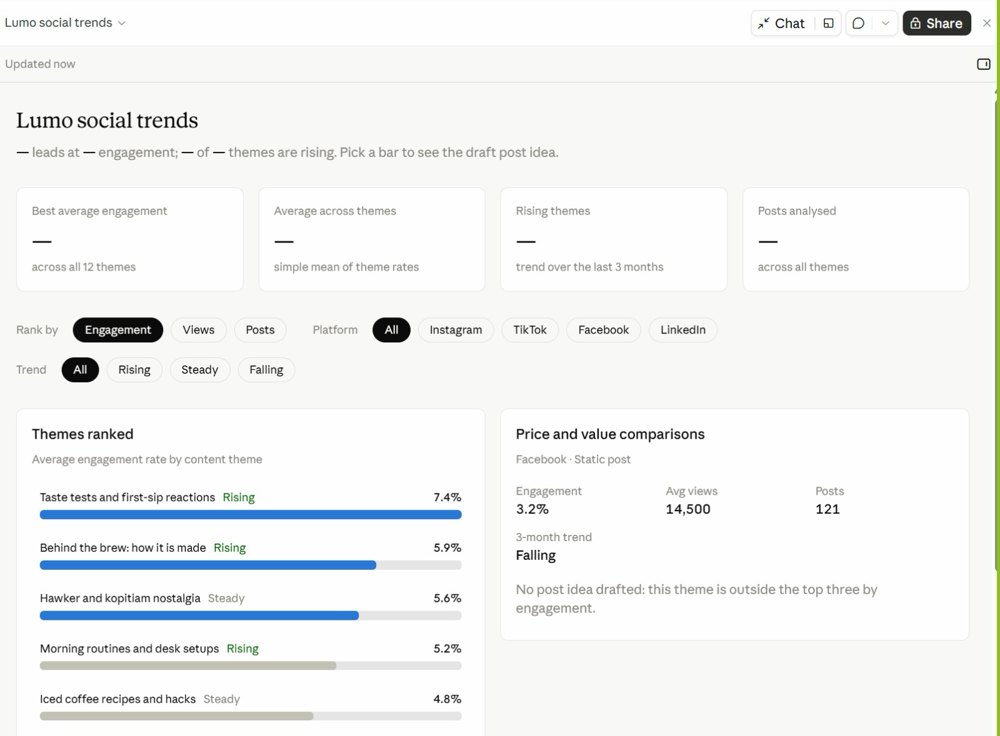

*Figure 7 — From the Class: Lumo Social Trends. A Live Artefact built in class from the social trends research.*

1. **Filters** — Rank by engagement, views or posts; filter by platform and trend.
2. **Themes ranked** — Taste tests and first-sip reactions lead at 7.4%, and are rising.
3. **Pick a bar** — The right-hand card shows that theme's numbers and a draft post idea.
4. **Spot the gap** — The summary cards show '—'. Ask Claude to fix them — always check the numbers.

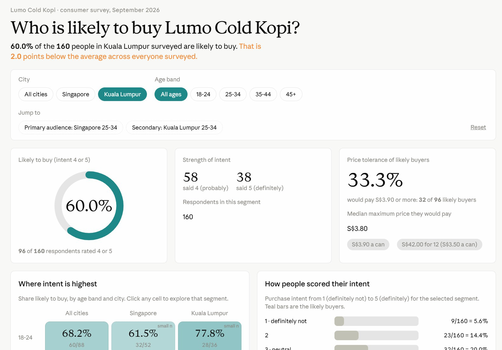

*Figure 8 — From the Class: Who Is Likely to Buy?. A Live Artefact on the consumer survey, filtered here to Kuala Lumpur.*

1. **Filters** — City and age band; Jump to opens the primary and secondary audiences.
2. **Headline** — 60.0% of 160 KL respondents are likely to buy — 2 points below the overall average.
3. **Price tolerance** — A third of likely buyers would pay S$3.90 or more.
4. **Explore** — Click any city and age cell to open that segment; small samples are flagged.

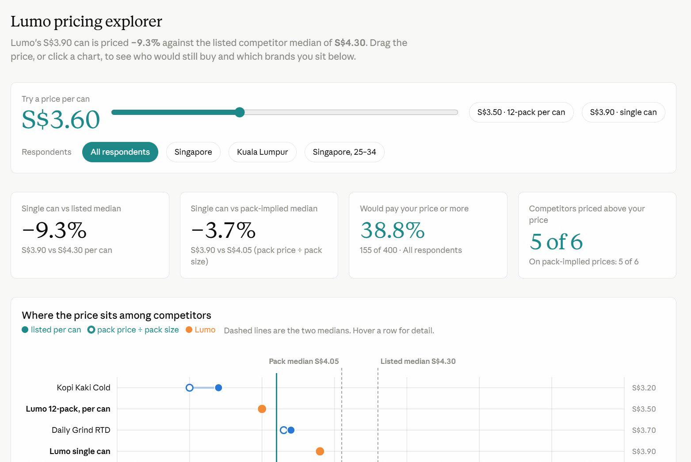

*Figure 9 — From the Class: Lumo Pricing Explorer. Drag the price and every card recalculates who would still buy.*

1. **Price slider** — Drag it, or pick S$3.50 (12-pack) or S$3.90 (single can).
2. **Against competitors** — Lumo's S$3.90 can is 9.3% below the S$4.30 competitor median.
3. **The chart** — Listed and pack prices per can, with both medians as dashed lines.

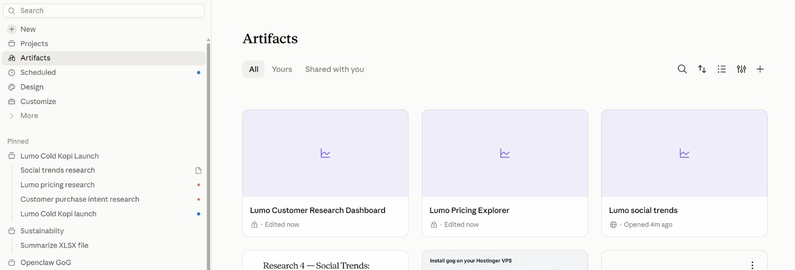

*Figure 10 — All Your Artefacts in One Place. Artifacts in the sidebar lists everything you have built, across every project.*

1. **Artifacts** — Open, search, sort and filter all your artefacts.
2. **Lock or globe** — A lock means private; a globe means shared by link.
3. **Pinned** — The Lumo project and its sessions stay pinned in the sidebar.


## Topic 02 — Connectors, Skills and Plugins

Google Drive and Gmail · the context window · Slides and Docs · Agent Skills · plugins and mods

#### Key concepts

| Concept | What it means |
|---|---|
| Connectors | Toggle Gmail, Drive and Calendar on from the + menu so Claude can reach data outside the chat. |
| Scope the folder | Point Claude at one Drive folder for the task — not your whole Drive. |
| Approval to send | Claude drafts, sends and replies in Gmail — sending asks for explicit approval by default. |
| Slides and Docs | Claude's own deck and document formats: shareable, editable, and downloadable as PowerPoint, Word or PDF. |
| Agent Skills | A folder of instructions Claude loads on demand, so a task runs the same way every time. |
| /skill-creator | Do the task once, verify the output, then let skill-creator write the SKILL.md for you. |
| Plugins | A bundle somebody else packaged — several skills plus the tools they need, installed in one click. |
| Mods | Changes to Claude's own interface or behaviour — a side panel, a status line, a slash command or a hook. |


### Connectors and the context window

A connector lets Claude reach a service outside the chat. These are the ones this course uses:

| Connector | What Claude can do |
|---|---|
| Google Drive | Search and read Sheets, Docs, Slides and PDFs; upload files; create folders; save Claude's output back to Drive. |
| Gmail | Search and read mail, draft messages, send / reply / forward with approval, and manage labels. |
| Google Calendar | View events, find availability, and create or update meetings. |
| Social and ads tools | Where your workspace has them, connectors for scheduling and ad platforms reach the same way — always with approval. |
| Approval by default | Claude asks for explicit approval before it sends, replies to or forwards an email. |
| Where to manage them | Individually from the + menu; account-wide under Customize → Connectors. |

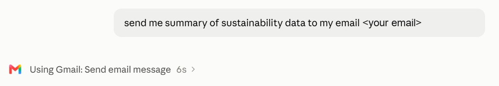

*Figure 11 — A Connector at Work: Gmail. One plain request — Claude chose the Gmail connector's Send email action.*

1. **Ask in plain English** — Say what to send and to whom; no menus to find.
2. **Watch the tool call** — 'Using Gmail: Send email message' names the connector and action. Click › for detail.
3. **Stay in control** — Ask for a draft first when the email goes to anyone but you.

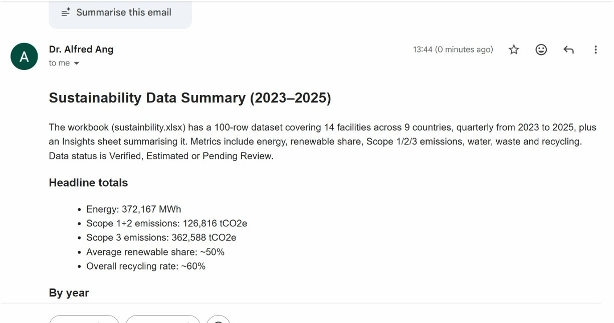

*Figure 12 — The Result in Gmail. The summary arrived seconds later, written from the project's sustainability workbook.*

1. **Read from the file** — Claude summarised the workbook: 14 facilities in 9 countries, 2023–2025.
2. **Ready to read** — Headings and bullets, formatted for email.
3. **Verify** — Spot-check one total against the source file before you forward it.

#### Keeping the context window lean

The context window is all the information the model can “see” when producing a response. Five levers decide what goes into it:

| Lever | What it adds |
|---|---|
| Conversation | Your prompt. The messages you send, including both text and attachments. |
| Project context | The files, folders and Drive folder the project reads from. |
| Connectors | The connected tools Claude can pull data from, and take actions in. |
| Skills | A set of instructions Claude follows for a repeatable workflow. |
| Instructions & memory | Project rules you wrote, and facts the project has learned. |

Every lab today pulls one of these levers — context in Lab 1, connectors in Lab 4, skills in Labs 5–7, and memory in Lab 10.

A window that fills up costs you in four ways:

| Problem | What happens |
|---|---|
| Context rot | Performance degrades. Recall of specific facts gets worse, the model starts confusing similar entities, and reasoning quality drops. |
| Tool confusion | Claude sees every tool definition. The more options competing for its attention, the more likely it picks the wrong one or fills in the wrong parameters. |
| Slower responses | The model processes every token on every turn. A bigger context means more work per message, which means longer waits before you see a reply. |
| Eats up your usage faster | Your entire context gets resent with each new message — so more tokens are burned per turn, and your limits are reached sooner. |

The fix is housekeeping: one job per thread, only the connectors you need, and only the files the job actually reads.


### Lab 4 — Connect Google Drive and Gmail

**Objective:** By the end of this lab you can connect Google Drive and Gmail, read campaign files from Drive and send an approved summary.

**Scenario:** The launch budget and timeline live in a shared Google Drive folder, not on your laptop. You upload the Lab 04 data folder to Drive, connect the Google Drive and Gmail connectors, and have the project read the budget from Drive, reconcile it against the launch brief, save the research brief back to Drive, and email you an approved summary. The budget sheet and the brief disagree on two lines — the project should catch it.

**You will build:** Drive and Gmail connected, the research brief saved to Drive, and an approved launch summary emailed to yourself.

**Tools:** Claude Projects, Google Drive connector, Gmail connector.

#### In the project

| Part | In this lab |
|---|---|
| Instructions — HOW | Uses: never send without approval — Claude drafts the email, you approve it. |
| Context — WHAT | Uses: the launch brief's budget, compared line by line with the Drive sheet. |
| Folder — WHERE | Reaches out: the Lumo Launch folder in Google Drive and your Gmail, by connector. |
| Scheduled — WHEN | Not used — runs when you send the prompt. |

#### Lab files

- Prompt PDF: labs-threads/lab-04-connect-drive-and-gmail/lab-04-connect-drive-and-gmail.pdf
- labs-threads/lab-04-connect-drive-and-gmail/data/Lumo Launch/lumo-launch-budget.csv
- labs-threads/lab-04-connect-drive-and-gmail/data/Lumo Launch/lumo-launch-timeline.csv

#### Tips

**Turning connectors on**

Click the **+** in the chat composer, hover **Connectors**, and toggle on only Google Drive and Gmail. You can manage them later under **Customize → Connectors**.

**If Claude says "insufficient scope"**

The connector is linked but was authorised without permission to read files. Fix it in **Settings → Connectors → Google Drive → Reconnect**, and accept the read access Google asks for. Then tell Claude to try again.

#### Step-by-step

1. Upload the Lab 04 data/Lumo Launch folder to your Google Drive.  
   *Why:* In real work the files are already there; the upload stands in for the shared team drive.
2. In the project, click + → Connectors and switch on Google Drive and Gmail, signing in to Google.  
   *Why:* Accept the read access Google asks for. A connector that shows Connected without read access fails with "insufficient scope".
3. Send the lab prompt with your own email address in place of `<YOUR EMAIL>`.  
   *Why:* No files are attached this time — the project reaches Drive itself.

   *PROMPT — copy into Claude*

   ```text
   Using Google Drive, open the "Lumo Launch" folder.

   1. Read lumo-launch-budget.csv and lumo-launch-timeline.csv.
   2. Compare the budget sheet, line by line, with the budget in
      lumo-launch-brief.md from our project context. Show both in one
      table and flag every line where they disagree. Do not decide
      which is right.
   3. Upload lumo-research-brief.docx from Lab 2 into the same Drive
      folder.
   4. Draft an email to <YOUR EMAIL> with the subject
      "Lumo launch - research and budget check": three bullet points
      from the research brief, the budget table with the disagreements
      flagged, the next milestone from the timeline, and a link to the
      brief in Drive.

   Show me the draft. Do not send it until I approve.
   ```

   > **Note:** Replace `<YOUR EMAIL>` with your own address. Send lab emails only to yourself.


4. Read the budget table Claude produces.  
   *Why:* Both total S$60,000, but Instagram is S$18,000 in the Drive sheet and S$20,000 in the brief, and Influencers is S$12,000 against S$10,000.
5. Confirm Claude flagged both lines instead of choosing one.  
   *Why:* That is your Lab 1 instruction at work. Two sources disagreeing is a decision for a human, not a guess for Claude.
6. Check that lumo-research-brief.docx now sits in the Lumo Launch folder in Drive.  
   *Why:* Saving outputs back to the team's folder is what makes the work findable by colleagues.
7. Read the draft email in full, then approve it.  
   *Why:* Gmail sends only after your explicit approval. Check the figures against the table before you click.
8. Open your inbox and confirm the email arrived with the Drive link working.  
   *Why:* Close the loop: an email you did not check arrived is an email you hope arrived.

#### Check

> **Check — you are done when:** Google Drive and Gmail are connected. Claude read both CSV files from the Lumo Launch folder, showed a budget table totalling S$60,000 on both sides, and flagged Instagram (S$18,000 vs S$20,000) and Influencers (S$12,000 vs S$10,000) without choosing between them. lumo-research-brief.docx is in the Drive folder, and the approved summary email arrived in your own inbox with a working link.

#### From the class

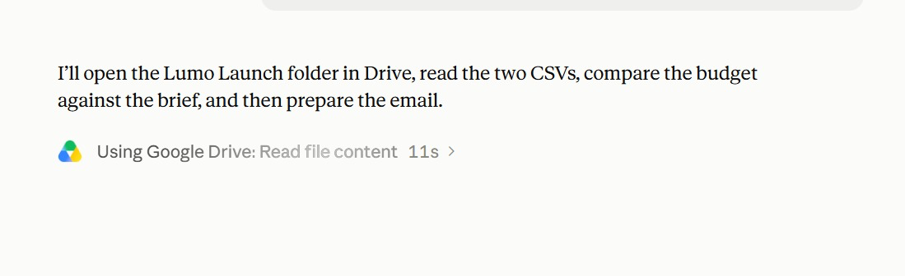

*Figure 13 — Lab 4 in Class: Reading from Google Drive. Claude states its plan, then calls the Google Drive connector.*

1. **Plan first** — Open the Lumo Launch folder, read both CSVs, compare the budget with the brief, then email.
2. **The tool call** — 'Using Google Drive: Read file content' — the connector at work.
3. **Watch it** — Each tool call shows its time; click › to see what was read.

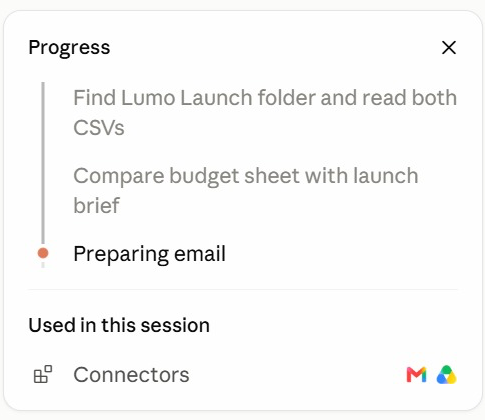

*Figure 14 — Following the Progress Panel. The progress panel ticks off each step and lists what the session used.*

1. **Steps** — Find the folder → compare budget and brief → prepare the email.
2. **Current step** — The orange dot marks the step in progress.
3. **Used in this session** — The connectors it called: Gmail and Google Drive.

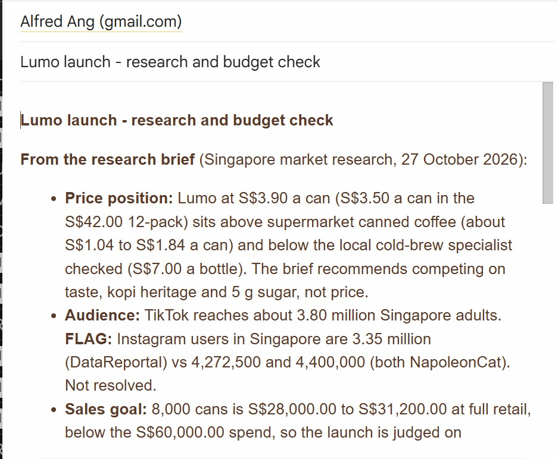

*Figure 15 — The Lab 4 Email. The research and budget check, written into Gmail from the Drive files.*

1. **From the brief** — Price position, audience and sales goal, quoted from the research brief.
2. **FLAG** — Conflicting Instagram figures are flagged, not hidden — resolve each FLAG.
3. **The numbers** — 8,000 cans is S$28,000–31,200 at retail, below the S$60,000 spend.


### Slides, Docs and built-in skills

| Format | What it is |
|---|---|
| Slides | A deck Claude builds and you edit in place — download as PowerPoint or PDF for the meeting. |
| Docs | A living document — a campaign brief, a plan — that you and Claude edit and comment on together. |
| Dashboards | A page of live numbers — the Live Artefact you build in Lab 3 is one. |
| Built-in skills | Claude's pptx, docx and xlsx skills load on their own when your request needs a file. |

You never name the skill. Ask for a deck or a document; Claude picks the format and the skill that builds it.


### Lab 5 — Create the Launch Deck and Campaign Brief

**Objective:** By the end of this lab you can produce a launch deck in Slides and a campaign brief in Docs from the project's research.

**Scenario:** The launch team meets on Friday and needs two things: a short deck for the room and a campaign brief everyone can work from. You ask the project for both. Claude builds the deck in Slides and the brief in Docs, choosing its built-in skills on its own, using the numbers from your research and dashboard. You check every figure, then download the deck as PowerPoint.

**You will build:** An eight-slide launch deck in Slides (downloaded as .pptx) and a campaign brief in Docs.

**Tools:** Claude Projects, Slides, Docs, built-in skills.

#### In the project

| Part | In this lab |
|---|---|
| Instructions — HOW | Uses: follow the brand guidelines for anything customer-facing. |
| Context — WHAT | Uses: the brand kit, for the name, tagline, price and claims. |
| Folder — WHERE | Uses: the Lab 2 research brief; the deck downloads as .pptx. |
| Scheduled — WHEN | Not used — runs when you send the prompt. |

#### Lab files

- Prompt PDF: labs-threads/lab-05-launch-deck-and-brief/lab-05-launch-deck-and-brief.pdf

This lab has no data folder — it works from what the project already holds.

#### Step-by-step

1. In the project, send the lab prompt.  
   *Why:* No attachments: the research brief, the dashboard data and the brand kit are all already in the project.

   *PROMPT — copy into Claude*

   ```text
   Using our research brief, the Market Insights dashboard and the
   brand kit, create two things for Friday's launch meeting.

   1. A launch deck in Slides, eight slides:
      1 Title - Lumo Cold Kopi: Kopi, Chilled Right
      2 The opportunity - the three survey numbers that matter most
      3 Who we are for - 25-34s in Singapore, with the evidence
      4 Competitors - a price ladder chart with Lumo highlighted
      5 Where they find us - a discovery channel chart
      6 The campaign - message, channels and dates
      7 Budget - the S$60,000 split, noting the two open questions
      8 Next steps and owners

      Use the Lumo brand colours. Real charts, not pictures of charts.

   2. A campaign brief in Docs: objective, audience, key message,
      proof points, channels, budget, timeline, KPIs, and a "claims
      we must not make" section.

   Every number must come from the research brief or the dashboard.
   List the source of each number at the end of the brief.
   ```

   > **Note:** You do not name a skill. Ask for a deck and a document; Claude picks the format and the built-in skill.


2. Open the deck when it appears and page through all eight slides.  
   *Why:* Check the charts are real charts — click one; a real chart has editable data behind it.
3. Check slide 2 and slide 4 against your research.  
   *Why:* 62% likely to buy, 74% among 25-34s, Instagram 34%; a price ladder from S$3.20 to S$5.60 with Lumo at S$3.90.
4. Check slide 7.  
   *Why:* The S$60,000 split should carry the two open questions from Lab 4 — Instagram and Influencers — not quietly pick one figure.
5. Open the campaign brief in Docs and read the "claims we must not make" section.  
   *Why:* It should rule out "healthy" and any claim the product sheet does not support. This section protects every post you write later.
6. Ask for one change to each, for example: Shorten slide 6 to three bullets.  
   *Why:* Slides and Docs are edited in place by conversation, the same way as an artefact.
7. Download the deck as PowerPoint and open it.  
   *Why:* The download is the file you take into the meeting — check the charts survived.

#### Check

> **Check — you are done when:** The deck has eight slides in the Lumo colours, with real charts for the price ladder and the discovery channels, the survey figures 62%, 74% and 34%, and a budget slide that shows S$60,000 with the Instagram and Influencers lines marked as open questions. The campaign brief in Docs has all nine sections, including "claims we must not make", and lists a source for every number. The deck opens in PowerPoint with its charts intact.


### Agent Skills

An Agent Skill is a folder of instructions Claude loads on demand, so a routine runs the same way every time. A skill has three layers, and only the first is always in context:

| Layer | What it holds | When Claude loads it |
|---|---|---|
| Metadata | Skill name and description. | Always in context — this is all Claude sees until the skill is triggered. |
| Instructions | The step-by-step workflow, written in a SKILL.md. | Loaded when the skill is triggered. |
| Resources | Supporting documents, templates and examples. | Loaded only when the skill needs them. |

#### Do, Verify, Save, Update

You never write a skill from a blank page. You do the task once, then save the verified routine:

1. **Do** — Do the task together with Claude once, step by step.
2. **Verify** — Review and refine until the output is right.
3. **Save** — Turn it into a skill using the /skill-creator skill.
4. **Update** — Refine it later and save over it — Claude confirms before replacing.

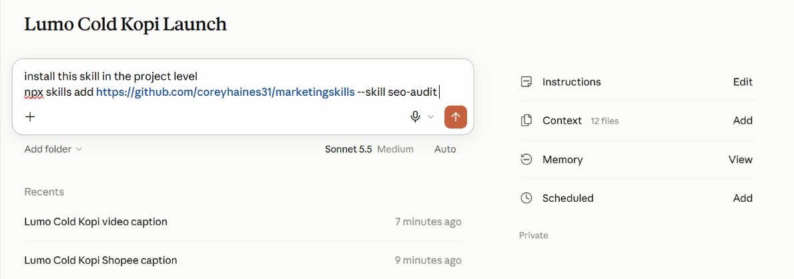

*Figure 16 — Install a Published Skill. Ask Claude to install a skill from GitHub into the project.*

1. **The request** — 'Install this skill in the project level', then the npx skills add command.
2. **Project level** — The skill is available in this project, beside the brand-voice skill you write in Lab 6.
3. **Check the source** — Read a third-party skill's SKILL.md first — it runs with your access.


### Lab 6 — Capture the Brand Voice as an Agent Skill

**Objective:** By the end of this lab you can rewrite content in the brand voice, verify it, and save the routine as a skill with /skill-creator.

**Scenario:** Four channels and two weeks of posts are coming, and they all have to sound like Lumo. You rewrite five off-brand captions with Claude until they are right, then use /skill-creator to turn that verified routine into a lumo-brand-voice skill. From then on, every thread in the project — and every colleague — loads the same voice by name.

**You will build:** A lumo-brand-voice Agent Skill, tested on a new caption.

**Tools:** Claude Projects, Agent Skills, /skill-creator.

#### In the project

| Part | In this lab |
|---|---|
| Instructions — HOW | Uses: the never-say-healthy rule becomes a check inside the skill. |
| Context — WHAT | Uses: lumo-brand-guidelines.md is the source the skill is written from. |
| Folder — WHERE | Uses: attach lumo-sample-captions.txt; the skill saves to Customize → Skills. |
| Scheduled — WHEN | Not used — runs when you send the prompt. |

#### Lab files

- Prompt PDF: labs-threads/lab-06-brand-voice-skill/lab-06-brand-voice-skill.pdf
- labs-threads/lab-06-brand-voice-skill/data/lumo-sample-captions.txt

#### Step-by-step

This lab has three blocks, sent at different times. Block 1 does the work once so you can verify it. Block 2 saves it as a skill: type /skill-creator in the composer, then paste the block. Block 3 tests the saved skill.

> **Note:** Block 2 begins with you typing /skill-creator in the composer — it is not part of the pasted text.

1. Open lumo-sample-captions.txt and read the five captions.  
   *Why:* Each breaks at least one brand rule — a wrong price format, a health claim, too much slang, too many hashtags.
2. In the project, attach the file and send Block 1.  
   *Why:* This is the Do step of Do · Verify · Save. You never write a skill from a blank page.

   **Block 1 — DO**

   Attach lumo-sample-captions.txt and send this first, on its own:

   *PROMPT — copy into Claude*

   ```text
   Rewrite the five captions in the attached file in the Lumo
   brand voice, following lumo-brand-guidelines.md.

   For each caption, show:
   - the original
   - your rewrite
   - every rule you applied, by name
   - any claim you removed, and why

   Then run these checks on each rewrite and show the result:
   price written as S$3.90; no "healthy" or medical claims; at
   most one Singlish word; #LumoKopi present; no more than five
   hashtags; ends with one clear call to action.
   ```

   **Now stop and read the output.** Ask for changes until every rewrite sounds right. Whatever you settle on here is exactly what the skill will reproduce.


3. Check each rewrite against the brand guidelines and refine until all five are right.  
   *Why:* This is the Verify step. Ask for changes in plain English; you are teaching the routine by correcting it.
4. Type /skill-creator in the composer, then paste Block 2 and send.  
   *Why:* skill-creator writes the SKILL.md from the run you just verified — name, description, instructions and examples.

   **Block 2 — SAVE**

   Type /skill-creator in the composer, then paste this:

   *PROMPT — copy into Claude*

   ```text
   Create a skill called lumo-brand-voice from what we just did.

   Description: Use when writing or reviewing any customer-facing
   Lumo Kopi content - social posts, captions, emails, video
   scripts or ads.

   It should rewrite or draft content in the Lumo voice, apply the
   brand rules, remove claims we cannot prove, and finish with the
   same checklist of checks we used. Include two of today's
   before-and-after examples as a resource.
   ```

   Approve the skill when Claude shows it to you, then open **Customize → Skills** and find it.


5. Read the skill Claude proposes, especially its description, and approve it.  
   *Why:* The description is the one part always in context. It decides when the skill loads, so it must say WHEN to use it.
6. Open Customize → Skills and find lumo-brand-voice.  
   *Why:* Your own skills are listed here. Built-in skills such as pptx are not — they show in the context panel when they load.
7. Start a new thread and send Block 3.  
   *Why:* A fresh thread proves the skill works without the earlier conversation — which is exactly how other threads will use it.

   **Block 3 — TEST**

   Start a new thread in the project and send:

   *PROMPT — copy into Claude*

   ```text
   Use lumo-brand-voice to write an Instagram caption announcing
   that Lumo Cold Kopi 12-packs are available on Shopee from
   1 December. It's super healthy and the best kopi in Singapore!
   ```

   The skill should load by itself, remove both unprovable claims and run its checklist.


8. Check the caption: no "healthy", no "best kopi in Singapore", S$ prices, #LumoKopi present.  
   *Why:* Both claims were traps. A skill that removes them has learned the rule, not just the examples.

#### Check

> **Check — you are done when:** lumo-brand-voice appears under Customize → Skills with a description that says when to use it. In a fresh thread, Block 3 loaded the skill without being asked to find it, and the caption it returned drops "healthy" and "best kopi in Singapore", includes #LumoKopi, uses at most five hashtags and ends with one call to action, followed by the checklist results.


### Skills, plugins and mods

A skill is one routine. A plugin is the whole setup — install the Marketing plugin and you get every skill, command and tool it contains.

|  | Skill | Plugin | Mod |
|---|---|---|---|
| Changes | How a task is done | A whole toolkit | Claude's own interface |
| Contains | One SKILL.md + resources | Skills, tools, agents, hooks | A panel, command, hook or status line |
| You get it by | Writing it with /skill-creator | Installing from Discover | Asking Claude to make one |
| Lumo example | lumo-brand-voice | Marketing plugin | A Next Lumo post panel |

#### Mods

- **What a mod is** — A change to Claude's own interface or behaviour, rather than to the work it does.
- **A panel or pane** — Something that stays beside the chat and updates — a running checklist, a campaign tracker.
- **A status line or toast** — A small always-visible signal, such as the active project or remaining usage.
- **A slash command** — Your own /command that starts a routine you use often.
- **A hook** — An action that runs automatically on an event — for example, before Claude sends anything.
- **Where to find them** — Under Customize, alongside Skills, Connectors and Plugins. Ask Claude to make one for you.


### Lab 7 — Add the Marketing Plugin and a Mod

**Objective:** By the end of this lab you can install a plugin, use its namespaced commands alongside your own skill, and build a mod that suggests the next social post.

**Scenario:** You wrote one skill yourself; now you install a toolkit somebody else packaged. Anthropic's Marketing plugin bundles several marketing skills behind namespaced commands. You install it, use /marketing:campaign-plan to stress-test the launch plan, and run /marketing:brand-review on the deck copy — then compare a plugin with the skill you wrote. Last, you build a mod of your own: a Next Lumo post panel beside the chat that suggests what to post next.

**You will build:** The Marketing plugin installed, a campaign plan review, a brand review of the launch copy, and a Next Lumo post mod.

**Tools:** Claude Projects, plugins, mods, Customize.

#### In the project

| Part | In this lab |
|---|---|
| Instructions — HOW | Uses: plugin commands follow the same project rules. |
| Context — WHAT | Uses: the brand guidelines, for /marketing:brand-review. |
| Folder — WHERE | Uses: the research brief, campaign brief and deck; the Next Lumo post mod reads the project. |
| Scheduled — WHEN | Not used — the mod suggests a post; nothing runs on a timer. |

#### Lab files

- Prompt PDF: labs-threads/lab-07-marketing-plugin/lab-07-marketing-plugin.pdf

This lab has no data folder — it works from what the project already holds.

#### Step-by-step

This lab has three blocks. Blocks 1 and 2 are commands from the Marketing plugin: install it first, then send Block 1 and, after reading its answer, Block 2. Block 3 asks Claude to build a mod.

> **Note:** Install the plugin first: Customize → Plugins → Browse, find Marketing, click Install. Then type /marketing in the composer to see its commands.

1. Open Customize → Plugins and browse the available plugins.  
   *Why:* Discover before you build: check whether someone has already packaged what you need.
2. Find the Marketing plugin, read what it contains, and click Install.  
   *Why:* One install brings several skills and commands at once — the difference between a plugin and a skill.
3. In the project composer, type /marketing and look at the commands it offers.  
   *Why:* Plugin commands carry the plugin's name as a prefix. That is how you tell them from a skill you wrote yourself.
4. Send Block 1 to stress-test the plan with /marketing:campaign-plan.  
   *Why:* The plugin's skill works with your project context: the campaign brief and research brief are already there.

   **Block 1 — PLAN**

   Send this in the project:

   *PROMPT — copy into Claude*

   ```text
   /marketing:campaign-plan Review the Lumo Cold Kopi launch using
   our campaign brief and research brief. Keep our objective,
   audience, budget and dates. Tell me:
   - what is missing from the plan,
   - the three biggest risks to the 1 December launch,
   - the KPIs you would track in the first two weeks, with targets.
   Do not change the S$60,000 budget.
   ```

   Read its answer in full before you send Block 2.


5. Read the risks and KPIs it proposes, and check the budget is unchanged at S$60,000.  
   *Why:* A plugin is someone else's judgement. Keep what fits your goal; question what does not.
6. Send Block 2 to review the deck copy with /marketing:brand-review.  
   *Why:* Two tools on one job: the plugin reviews, and your lumo-brand-voice skill holds the house rules it checks against.

   **Block 2 — REVIEW**

   Then send:

   *PROMPT — copy into Claude*

   ```text
   /marketing:brand-review Review the copy on slides 1, 2 and 6 of
   our launch deck against lumo-brand-guidelines.md. List each
   change you would make and the rule behind it.
   ```

   Compare its findings with what your lumo-brand-voice skill would flag.


7. Open Customize and look at the Mods section.  
   *Why:* Mods change Claude's interface itself — a panel, a status line, a slash command or a hook. You can install one, or ask Claude to make one.
8. Send Block 3 and read what the mod will do before you let Claude install it.  
   *Why:* You describe the behaviour in plain English and Claude writes the mod. Check it only suggests — a mod that could post would need your approval rules too.

   **Block 3 — MOD**

   Then send:

   *PROMPT — copy into Claude*

   ```text
   Make me a mod: a panel called "Next Lumo post" that stays
   beside the chat in this project.

   - If social-calendar.csv is in the project, show the next post
     due from today: date, platform, format, hook and call to action.
   - If there is no calendar yet, suggest one next post instead:
     use the top content theme in lumo-research-brief.docx and the
     lumo-brand-voice skill, and say which platform and day suit it.
   - Add a Refresh button and show when it last updated.
   - It only suggests: never post, publish or send anything.

   Tell me what the mod will do and where it will appear before
   you install it.
   ```

   Open the **Next Lumo post** panel and check its suggestion against the brand kit.


9. Open the Next Lumo post panel beside the chat and read its suggestion.  
   *Why:* No calendar yet, so it suggests a post from the research brief's top theme. Check the brand voice, S$3.90 and no "healthy". After Lab 8 it shows the calendar's next post.

#### Check

> **Check — you are done when:** The Marketing plugin is installed and its /marketing: commands appear in the composer. /marketing:campaign-plan returned the gaps, three launch risks and two-week KPIs with targets while keeping the S$60,000 budget and the 1 December date. /marketing:brand-review reviewed the deck copy. You can explain the difference between lumo-brand-voice (a skill you wrote), the Marketing plugin (a packaged bundle) and a mod (a change to Claude's interface). The Next Lumo post panel sits beside the chat and suggests one on-brand post — S$ prices, no health claim — without posting anything.


## Topic 03 — Content Production and Scheduled Work

Social posts in parallel threads · a launch video · scheduled tasks · memory and usage

#### Key concepts

| Concept | What it means |
|---|---|
| One thread per channel | The lead agent gives Instagram, TikTok, LinkedIn and Facebook a thread each, then merges one calendar. |
| Skill inside a thread | Every thread loads the same brand-voice skill, so four channels still sound like one brand. |
| Video as code | Claude writes and runs the code that turns a storyboard and your images into an MP4. |
| Scheduled tasks | A prompt that runs on a timetable inside the project — daily, weekly or monthly — while you are away. |
| Approval stays human | A scheduled task drafts and emails the post to you. Publishing is still your click. |
| Usage per thread | Project settings show the tokens the lead agent and each thread used — the cost of parallel work. |


### Social content in parallel threads

Each platform has its own format, so Lab 8 gives every platform its own thread:

| Platform | Format and rules |
|---|---|
| Instagram | Carousel or Reel. Hook in the first line; caption up to 2,200 characters; 3–5 hashtags. |
| TikTok | 9:16 video, 15–30 s. A hook in the first 2 seconds; on-screen text; one call to action. |
| LinkedIn | Founder or team voice; the story behind the product; no more than 3 hashtags. |
| Facebook | Community and offers; a clear link to buy; questions that invite comments. |

Every thread loads lumo-brand-voice, so four formats still sound like one brand.

#### From brief to calendar

1. **Brief the lead** — One message: the goal, the dates, the channels and the skill to use.
2. **Split by channel** — The lead agent starts one thread per platform with its own spec.
3. **Draft in parallel** — Each thread drafts its posts using the brand-voice skill.
4. **Merge the calendar** — The lead agent merges the drafts into one dated calendar.
5. **Check and approve** — You check claims, prices and dates before anything is scheduled.


### Lab 8 — Create and Schedule Social Posts in Parallel Threads

**Objective:** By the end of this lab you can produce a two-week, four-platform social calendar with one thread per channel, and schedule the daily post.

**Scenario:** Launch fortnight needs ten posts across Instagram, TikTok, LinkedIn and Facebook. Each platform has its own format, so you hand the job to the lead agent and let it start one thread per platform. Every thread loads lumo-brand-voice, drafts its posts to its platform's spec, and the lead agent merges them into one dated calendar. Once you have checked it, you schedule a task that emails you each day's post at 9:00am as a draft.

**You will build:** social-calendar.csv with ten dated posts across four platforms, lumo-social-posts.docx with the full copy, and a weekday 9:00am scheduled task that emails each day's post as a draft.

**Tools:** Claude Projects, lead agent and threads, Agent Skills, scheduled tasks, Gmail connector.

#### In the project

| Part | In this lab |
|---|---|
| Instructions — HOW | Uses: brand voice, S$ prices, and never publish without your approval. |
| Context — WHAT | Uses: the brand kit — every post is checked against its prices and claims. |
| Folder — WHERE | Adds: social-calendar.csv and lumo-social-posts.docx, saved in the project. |
| Scheduled — WHEN | NEW: Today's Lumo post, weekdays at 9:00am — emails you each day's post as a draft. |

#### Lab files

- Prompt PDF: labs-threads/lab-08-social-posts-threads/lab-08-social-posts-threads.pdf
- labs-threads/lab-08-social-posts-threads/data/social-calendar-template.csv

#### Step-by-step

This lab has two blocks. Block 1 creates the calendar, one thread per platform. Block 2 schedules the daily post, once you have checked the calendar.

> **Note:** Attach social-calendar-template.csv from the Lab 08 data folder. Replace `<YOUR EMAIL>` in Block 2.

1. In the project, attach social-calendar-template.csv and send the lab prompt.  
   *Why:* This is the same pattern as Lab 2 — one message, independent subjects — applied to production instead of research.

   **Block 1 — CREATE**

   Send this to the lead agent:

   *PROMPT — copy into Claude*

   ```text
   Create the launch social calendar for Lumo Cold Kopi: ten posts,
   one each weekday from Tuesday 1 December to Monday 14 December
   2026, using social-calendar-template.csv for the columns.

   Split the drafting into four threads, one per platform, and run
   them in parallel:
   - Instagram: 3 posts (carousel or Reel), caption with a hook in
     the first line, 3-5 hashtags.
   - TikTok: 3 posts, each a 15-second video script with a hook in
     the first 2 seconds and on-screen text.
   - LinkedIn: 2 posts in the founder's voice, the story behind the
     product, no more than 3 hashtags.
   - Facebook: 2 posts for community and the 12-pack offer.

   Every thread must use the lumo-brand-voice skill and our top
   content theme from the research. The 1 December launch-day
   post is an Instagram Reel; TikTok follows on 2 December.

   Then merge the threads into social-calendar.csv (date, platform,
   format, hook, copy, hashtags, visual idea, call to action) and
   lumo-social-posts.docx with the full copy. Report the brand-voice
   checklist result for every post, and list any post that failed.
   ```

   Check the calendar in the next steps before you schedule anything.


2. Watch the lead agent start the four platform threads.  
   *Why:* Each thread has its own spec and its own context window, so the TikTok scripts never crowd out the LinkedIn story.
3. Open the Instagram thread and check it loaded lumo-brand-voice.  
   *Why:* The skill you wrote in Lab 6 is now doing its real job: keeping four parallel writers on one voice.
4. When the merged calendar arrives, count the rows and check the dates.  
   *Why:* Ten rows, weekdays only: 1, 2, 3, 4, 7, 8, 9, 10, 11 and 14 December. Instagram 3, TikTok 3, LinkedIn 2, Facebook 2.
5. Read the brand-voice checklist results.  
   *Why:* Every post should pass. If one fails, ask the lead agent to send it back to its thread for a fix.
6. Spot-check three posts against the campaign brief's "claims we must not make".  
   *Why:* Parallel production is fast; a human check on the claims is what makes it safe to publish.
7. Open lumo-social-posts.docx and confirm the copy matches the calendar.  
   *Why:* The calendar is what the scheduled task you create next reads every morning.
8. Send Block 2 with your own email address in place of `<YOUR EMAIL>`.  
   *Why:* The task runs inside the project, so it inherits the instructions, context, memory and the brand-voice skill — the prompt stays short.

   **Block 2 — SCHEDULE**

   Then send this to the lead agent:

   *PROMPT — copy into Claude*

   ```text
   Schedule a recurring task in this project: "Today's Lumo post",
   every weekday at 9:00am. Take today's row from
   social-calendar.csv, polish it with lumo-brand-voice, check every
   price and claim against the brand kit, and email it to
   <YOUR EMAIL> as a draft with the subject
   "Today's Lumo post - <date>". Never publish anything. If there
   is no row for today, email "No Lumo post scheduled today".

   Show me the task before you save it, then run it once now as a
   test, using 1 December 2026 as today.
   ```

   Check the test email in your inbox, then open **Scheduled** and confirm the task is listed for weekdays at 9:00am.


9. Read the task before it is saved: name, prompt, and weekdays at 9:00am.  
   *Why:* A task scheduled at the wrong time is a silent failure. Weekdays only — the calendar has no weekend posts.
10. Open your inbox and read the test email for 1 December.  
   *Why:* It should be the Instagram launch Reel from your calendar, polished, with S$ prices and no "healthy" claim — a draft, not a published post.
11. Open Scheduled in the project and confirm the task is listed. Then open the Next Lumo post panel from Lab 7 and click Refresh.  
   *Why:* From Scheduled you can pause, edit or run a task now. The panel now reads the calendar and shows the same 1 December post.

#### Check

> **Check — you are done when:** social-calendar.csv has ten rows dated on the ten weekdays from 1 to 14 December 2026 — Instagram 3, TikTok 3, LinkedIn 2, Facebook 2 — with the 1 December launch post an Instagram Reel and TikTok on 2 December. Every post passed the lumo-brand-voice checklist, none uses "healthy", every price is written S$3.90 or S$42.00, and lumo-social-posts.docx carries the same copy. Today's Lumo post is listed under Scheduled for weekdays at 9:00am; it drafts and emails only, and nothing was published.

#### From the class

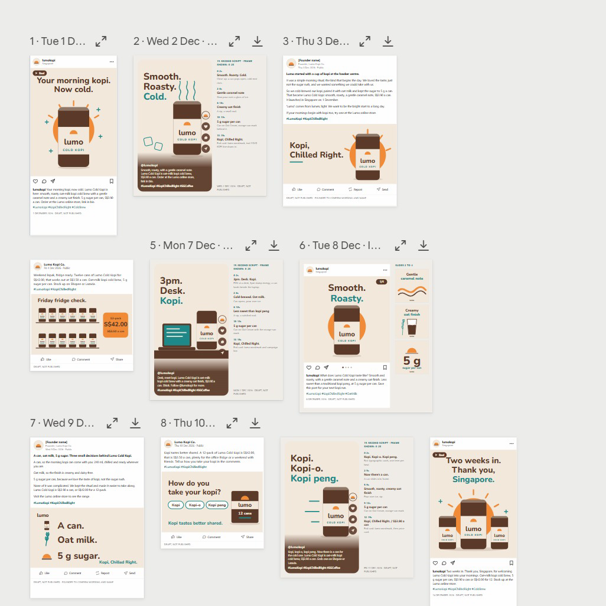

*Figure 17 — From the Class: Two Weeks of Posts. The Lab 8 posts laid out by date — every one a draft, not published.*

1. **One calendar** — Dated posts from 1 to 14 December across the four platforms.
2. **One voice** — The brand-voice skill keeps every hook and caption consistent.
3. **Review** — Expand or download any post; each is marked DRAFT, NOT PUBLISHED.


### The video pipeline

Claude does not edit video by hand — it writes and runs the code that renders it. The work runs in five stages:

1. **Script** — Five lines, three seconds each — hook, problem, product, proof, call to action.
2. **Storyboard** — One frame per line: which image, which on-screen text, which motion.
3. **Render** — Claude writes and runs code that animates your images and text into an MP4.
4. **Check** — Length, size 1080 × 1920, brand colours, every claim true, end card with the price.
5. **Refine** — Ask for timing or text changes in plain English and render again.

#### Video specifications

| Spec | Requirement |
|---|---|
| Format | Vertical 9:16, 1080 × 1920 pixels, MP4 — fits Reels, TikTok and Shorts. |
| Length | 15 seconds: five scenes of three seconds each. |
| Text | Large, high-contrast captions — most people watch with the sound off. |
| Brand | Lumo colours and logo; the end card shows the price and the campaign hashtag. |
| Assets | Only the supplied product images — never a real person's likeness or a stock logo. |
| Fallback | No video tools in the session? Claude builds an animated HTML version to screen-record. |


### Lab 9 — Produce a 15-Second Launch Video

**Objective:** By the end of this lab you can script, storyboard and render a vertical launch video from supplied brand assets.

**Scenario:** The TikTok and Instagram posts need a launch video. You give the project the supplied product images and logo; one thread writes a five-scene script and storyboard with lumo-brand-voice, another writes and runs the code that animates the images and captions into a 15-second, 1080 × 1920 MP4. You check it frame by frame and ask for changes in plain English.

**You will build:** lumo-launch-15s.mp4 (1080 × 1920, 15 seconds), with its script and storyboard.

**Tools:** Claude Projects, threads, code execution.

#### In the project

| Part | In this lab |
|---|---|
| Instructions — HOW | Uses: brand voice for the script; nothing is published. |
| Context — WHAT | Uses: the brand kit, for the tagline, price and call to action. |
| Folder — WHERE | Adds: attach the video assets; the script, storyboard and lumo-launch-15s.mp4 are saved. |
| Scheduled — WHEN | Not used — runs when you send the prompt. |

#### Lab files

- Prompt PDF: labs-threads/lab-09-launch-video/lab-09-launch-video.pdf
- labs-threads/lab-09-launch-video/data/video-assets/lumo-can.png
- labs-threads/lab-09-launch-video/data/video-assets/lumo-12pack.png
- labs-threads/lab-09-launch-video/data/video-assets/lumo-logo.png
- labs-threads/lab-09-launch-video/data/video-assets/scene-hawker.png
- labs-threads/lab-09-launch-video/data/video-assets/scene-office.png

#### Step-by-step

1. Open the Lab 09 data/video-assets folder and look at the five images.  
   *Why:* These are the only images the video may use. Supplying assets is how you keep likenesses and logos safe.
2. In the project, attach the folder and send the lab prompt.  
   *Why:* Two threads, but not in parallel this time: the render thread waits for the script. The lead agent manages that order.

   *PROMPT — copy into Claude*

   ```text
   Make a 15-second vertical launch video for Lumo Cold Kopi, using
   only the five images in the attached video-assets folder.

   Use two threads:
   Thread 1 - SCRIPT: with lumo-brand-voice, write five scenes of
     three seconds each: hook, problem, product, proof, call to action.
     For each scene give the image, the on-screen text (max 6 words)
     and the motion. Save it as lumo-video-storyboard.md.
   Thread 2 - RENDER: when the storyboard is ready, write and run
     code that renders it to lumo-launch-15s.mp4: 1080 x 1920, 30 fps,
     exactly 15 seconds, large high-contrast captions in the Lumo
     colours, a gentle zoom on each image, and an end card with the
     logo, "From S$3.90" and #KopiChilledRight.

   If you cannot render video in this session, build the same thing
   as an animated HTML page at 1080 x 1920 and tell me, so I can
   screen-record it. Report the file's duration and size when done.
   ```

   > **Note:** Attach the whole video-assets folder. Use only the supplied images — never a real person's likeness or another brand's logo.


3. Read the storyboard when Thread 1 finishes.  
   *Why:* Five scenes, three seconds each, captions of six words or fewer, and no health claims — the brand-voice skill applies to scripts too.
4. When the video arrives, check the reported duration and size.  
   *Why:* Exactly 15 seconds and 1080 × 1920. A wrong size is the most common reason a platform crops your captions.
5. Play it through, then scrub it frame by frame.  
   *Why:* Check every caption is readable with the sound off and the end card shows the logo, From S$3.90 and #KopiChilledRight.
6. Ask for one change, for example: Hold the end card for one second longer and shorten scene 2.  
   *Why:* The video is code, so a change is a re-render, not a re-edit. Check the length is still 15 seconds afterwards.
7. If Claude built the HTML fallback instead, open it full screen and screen-record 15 seconds.  
   *Why:* Same storyboard, different renderer. The checks stay the same.

#### Check

> **Check — you are done when:** lumo-launch-15s.mp4 is 1080 × 1920, 30 fps and 15 seconds long, uses only the supplied images, shows five scenes with captions of six words or fewer in the Lumo colours, and ends on a card with the logo, "From S$3.90" and #KopiChilledRight. lumo-video-storyboard.md sits beside it and matches what plays. No scene makes a health claim.


### Scheduled tasks

A scheduled task has six parts. Write each one down before you schedule anything:

| Part | What to decide |
|---|---|
| Prompt | Exactly what to do each run — written like a lab prompt, with the checks included. |
| Frequency | Daily, weekdays, weekly or monthly. |
| Time | When it runs, in your time zone — for example, weekdays at 9:00am. |
| Where it runs | Inside the project, so it reads the same goal, context, memory and skills. |
| Output | Where the result goes — an email draft, a file in Drive, a note in the project. |
| Approval | The step a human still takes — the task drafts, you publish. |

#### Examples for the launch

| Schedule | Task |
|---|---|
| Daily post, weekdays 9:00am | Take today's row from the social calendar, polish it with lumo-brand-voice and email it to me for approval. |
| Weekly report, Mondays 8:00am | Summarise last week's posts from the social calendar and anything new in the Lumo Launch Drive folder in five bullet points. |
| Monthly scan, 1st at 10:00am | Check the six competitors for new products or price changes and update the research brief. |

A local task needs the app open. To keep tasks running with the laptop closed, give the project a cloud environment in Project settings → Environment.

#### Responsible marketing with Claude

Speed is only useful if what goes out is true and fair. Keep these rules on every job:

| Rule | In practice |
|---|---|
| Claims you can prove | “5 g sugar” is on the label. “Healthy” is a claim Lumo cannot substantiate — never use it. |
| Consent for email | Email only people who opted in. Lab emails go to yourself, never to real customers. |
| No real likenesses | Do not generate a real person, influencer or competitor logo into an ad. |
| Disclose partnerships | Influencer posts are labelled as paid partnerships. |
| A human publishes | Claude drafts and schedules drafts; a person approves every public post. |
| Keep the source | Keep the research files, so every number in a post can be traced back. |


### Lab 10 — Schedule the Weekly Report and Review the Project

**Objective:** By the end of this lab you can schedule a weekly report beside the daily post, edit project memory and review thread usage.

**Scenario:** Lab 8 scheduled the daily post. The launch also needs a report every Monday, and nobody should have to remember it. You schedule it inside the project beside the daily post, then do the housekeeping a real project needs: correct its memory when a plan changes, and read the usage of the lead agent and each thread to see what parallel work costs.

**You will build:** A weekly-report scheduled task beside Lab 8's daily post, an updated project memory and a usage review.

**Tools:** Claude Projects, scheduled tasks, memory, Gmail connector.

#### In the project

| Part | In this lab |
|---|---|
| Instructions — HOW | Reviews: which instructions are now out of date. |
| Context — WHAT | Reviews: which context files the launch-date change affects. |
| Folder — WHERE | Updates: project memory records the 8 December Singapore launch. |
| Scheduled — WHEN | NEW: Weekly launch report, Mondays at 8:00am — beside Lab 8's daily post. |

#### Lab files

- Prompt PDF: labs-threads/lab-10-schedule-and-review/lab-10-schedule-and-review.pdf

This lab has no data folder — it works from what the project already holds.

#### Step-by-step

This lab has three blocks. Block 1 schedules the weekly report. Block 2 changes the launch plan through project memory. Block 3 asks the project to review itself.

> **Note:** Scheduled tasks that run locally need the desktop app open. To run them with your laptop closed, add a cloud environment in Project settings → Environment.

1. Send Block 1 with your own email address in place of `<YOUR EMAIL>`, and read the task before it is saved.  
   *Why:* Mondays at 8:00am. The task runs inside the project, so it inherits the goal, instructions, context and memory — the prompt stays short.

   **Block 1 — SCHEDULE**

   Send this to the lead agent:

   *PROMPT — copy into Claude*

   ```text
   Schedule a recurring task in this project: "Weekly launch
   report", Mondays at 8:00am. Summarise last week's posts from
   social-calendar.csv and anything new in the Lumo Launch Drive
   folder in five bullet points, and email the summary to
   <YOUR EMAIL>. Draft only - do not send anything else.

   Show me the task before you save it.
   ```

   Open **Scheduled** and confirm both tasks are listed: Today's Lumo post from Lab 8, and Weekly launch report.


2. Open Scheduled in the project and confirm both tasks are listed.  
   *Why:* Today's Lumo post from Lab 8 and the weekly report: two timetables, one project. This is where you would add a monthly competitor scan next.
3. Send Block 2, then read the list of things that depend on the date.  
   *Why:* Expect the calendar, Task 1, the deck's title slide and timeline, and the brief. Memory is how one fact reaches every thread.
4. Open Project settings → Memory and find the new launch-date entry. Edit it if the wording is wrong.  
   *Why:* The project writes memory, but you own it. Delete anything you would not want every future thread to believe.

   **Block 2 — MEMORY**

   Send this to the lead agent:

   *PROMPT — copy into Claude*

   ```text
   Remember this for the project: the Singapore launch has moved
   from 1 December to 8 December 2026. Kuala Lumpur is unchanged.
   Tell me everything in the project that depends on the launch
   date - posts, tasks, the deck, the brief - and propose the
   changes. Do not make them yet.
   ```

   Open **Project settings → Memory**, find the new entry, and correct the wording if needed.


5. Send Block 3 at the end of the lab.  
   *Why:* A project that can list its own threads and outputs is one a colleague can pick up tomorrow.
6. Open Project settings → Usage and read the lead agent's and each thread's tokens.  
   *Why:* Parallel threads finish faster but use more in total. Compare the research threads from Lab 2 with the single-thread labs.

   **Block 3 — REVIEW**

   Send this at the end of the lab:

   *PROMPT — copy into Claude*

   ```text
   Review this project for me: list the threads you started today,
   what each produced, and where each output is saved. Then tell
   me which context files, instructions or memory entries are now
   out of date.
   ```

   Compare its list with **Project settings → Usage**, which shows the tokens used by the lead agent and each thread.


#### Check

> **Check — you are done when:** Two tasks are listed under Scheduled — Today's Lumo post from Lab 8 on weekdays at 9:00am and Weekly launch report on Mondays at 8:00am — both drafting and emailing only, with nothing published. Project memory records the 8 December Singapore launch, and the lead agent listed what depends on it. Project settings → Usage shows tokens for the lead agent and for each thread you started today.


## Wrap-Up

Across ten labs you took one product launch from an empty project to a researched, branded and scheduled campaign.

#### What you built

- The Lumo Cold Kopi Launch project, with a goal, instructions, context and memory.
- A market research brief built from four parallel threads, with conflicts flagged.
- A Market Insights Live Artefact dashboard, saved and downloaded.
- Google Drive and Gmail connected, with an approved summary sent to yourself.
- A launch deck in Slides and a campaign brief in Docs.
- A lumo-brand-voice Agent Skill and the Marketing plugin.
- Two weeks of social posts across four platforms, drafted in parallel threads.
- A 15-second vertical launch video.
- Scheduled tasks that draft the daily post and the weekly report for your approval.

#### The habit to keep

- Give long-running work a project with a clear goal, not a string of chats.
- Split big jobs into threads, one subject each, and let the lead agent merge them.
- Check every figure and claim against the source before anything goes out.
- Write a routine down once as a skill instead of retyping it every time.
- Schedule the drafting; keep the publishing click for yourself.

#### Next steps

- **Start one real Project** — Give your next campaign a project with a goal, instructions and context.
- **Split one job into threads** — Next time you research competitors, give each one its own thread.
- **Capture your brand voice** — Turn your real brand guide into a skill your whole team shares.
- **Schedule one routine** — Pick the post or report you produce every week and schedule the draft.
- **Browse Discover** — See which plugins already exist before you write a skill someone has packaged.


## Glossary

| Term | Meaning |
|---|---|
| Agent Skill | A folder containing a SKILL.md of instructions that Claude loads on demand when the task matches its description. |
| Artefact | A self-contained output Claude builds — a document, dashboard or tool — shown beside the chat rather than inside it. |
| Claude Project | A workspace for one long-running goal, with its own instructions, context, memory, threads and scheduled tasks. |
| Connector | An integration that lets Claude reach an outside service such as Google Drive, Gmail or Calendar. |
| Context | Reference material a project reads but never edits — files, a folder, a Google Drive folder or a GitHub repository. |
| Effort | How hard a model thinks before it answers. Higher effort is more thorough and uses more of your limit. |
| Instructions | Standing rules you write once that every session in a project follows — how Claude must behave. |
| Lead agent | The project's coordinator: it plans each job, starts threads and merges their results. Also called the coordinator. |
| Live Artefact | An artefact that persists in your workspace, keeps its state, and can refresh its data when reopened. |
| MCP | Model Context Protocol — the open standard connectors use to expose tools and data to Claude. |
| Memory | Facts and decisions a project writes down as it works, readable by every thread and editable by you. |
| Mod | A change to Claude's own interface or behaviour, such as a side panel, status line, slash command or hook. |
| Plugin | A packaged bundle of skills, tools, agents and hooks, installed in one step. |
| Scheduled task | A prompt a project runs automatically on a timetable. |
| Session | One conversation with Claude, with its own context window. A project holds many sessions. |
| SKILL.md | The Markdown file at the heart of an Agent Skill: name, description and instructions. |
| Thread | One parallel worker inside a project, started by the lead agent with a focused brief and its own context window. |
